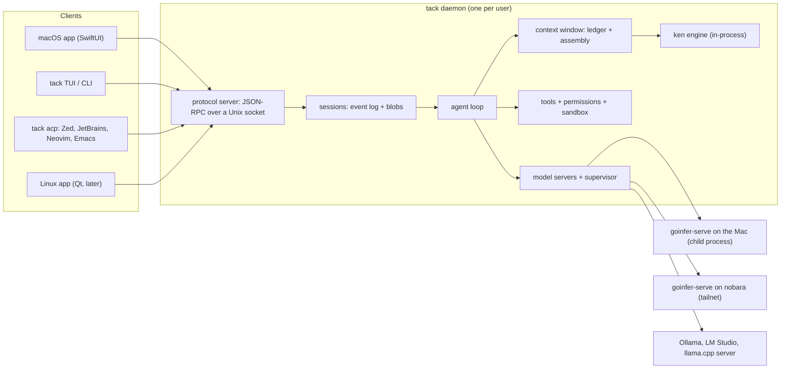

# tack — design

> **Status: DRAFT 2026-10-16, for the owner's review. Nothing is built.** Scope: a Go daemon with a CLI and TUI, then a
> native macOS app. A Qt Linux app follows later and is designed for here, not built. One consolidated doc by request:
> it covers the new repo and the changes the design needs in ken, goinfer and aikit.
>
> **tack runs on local models only.** It calls no hosted model. goinfer is its first-class model server; Ollama, LM
> Studio and llama.cpp's server work through one OpenAI-compatible adapter. Claude's part is writing tack's code, through
> Claude Code and vscode-claude on the owner's subscription, not running inside it.
>
> **Revised the same day.** The first draft assumed tack's model would be Claude, called through the API; that
> assumption is gone, along with its sections on API pricing, subscription terms and a Claude Code engine. A cold
> review's findings stay folded in: the sandbox and the daemon's own controls (§6.6), message-structure rules (§6.3),
> the evaluation's statistics and leakage (§15), daemon start-up (§6.1) and packaging (§11.1). The owner's decisions so
> far are marked in §1.
>
> **Revised again, 2026-10-16:** a second review's findings folded in, with the owner's picks — retrieved context
> counts against a cumulative budget, not a per-turn one (§7.2, §7.4); the structural tools fold into `symbol` and
> `read` (§6.5); speed is compared as capped time per task (§15). Also: the log keeps the model's exact output (§6.2),
> compaction never touches the system prompt (§7.6), the ledger counts dead weight (§7.1), rule sections load on the
> first tool of their kind (§2.3), side jobs never evict an open turn's KV (§8.3), `bash` edits are attributed by
> hashes (§7.5), the shell checks commands as they run (§6.6), and the client token is checked once per connection
> (§9.2).
>
> **And again (owner's direction):** the macOS app is one install. It bundles goinfer's server built for Metal and
> ken's embedding model, and downloads a model sized to the Mac on first run; Ollama, LM Studio or a remote goinfer are
> optional (D7, §8.1, §11.11, §11.12).
>
> Facts about ken, goinfer and aikit were read from the trees on 2026-10-16 (ken `611e12c`, goinfer `74716eb4b`).
> Facts about the field are dated and sourced at the end. Anything marked *proposed* is a number or rule to be
> registered before it is measured, not a measurement.

---

## 0. Summary

**What.** A coding agent for the Mac that runs entirely on local models, with one long-lived daemon per user, driven
from a terminal or a native app. It is built on the owner's own stack: **ken** for code search and context, **goinfer**
for inference, **aikit** under both. Nothing leaves the owner's machines: no hosted model, no API key, no telemetry.

**Why it can be good.** Local agents stumble on two things. The window is small, so long tool schemas and whole-file
reads crowd out the work; and small models emit malformed tool calls that break the session. tack is designed against
both. ken puts the right few thousand tokens in the window instead of whole files, and goinfer constrains every tool
call so it cannot be malformed: on the agent transcript goinfer measured, a 7B model's unusable calls went from 14 of
111 to 0.

**The bets**, in the order they get tested:

1. **Context the user can see.** Every request's contents are recorded in a ledger: what is in the window, where it
   came from, whether it is stale, how many tokens it took, whether goinfer reused it from its cache. The user can
   inspect it, pin items and exclude them.
2. **The right context for a small window.** tack is designed for a 16k-token window, the size of the one agent setup
   goinfer has measured working. Retrieval goes through ken and symbol-level reads; tack's own fixed prompt has a hard
   budget; long instruction files are read by section.
3. **Fast turns on local hardware.** Context assembly is append-only, so goinfer reuses its cached prefix and a turn
   prefills only its new tail. The research part (approximate reuse of KV after a context change) comes last, and only
   if measurement shows the exact part leaves a gap.

**Where the model runs, for the owner.** goinfer's records show one configuration measured to work under a real
agent's tool schema: Qwen2.5-7B-Instruct `q4_k_m` on nobara's RTX 2070 SUPER (8 GB), with a 16k window. On the 16 GB
Mac, 3B models were too small, and a 7B did not fit the memory actually available on the CPU path. So the owner's
default is tack on the Mac with its model served from nobara over the tailnet, until E0 finds a Mac configuration that
works (§8).

**For everyone else, one install (D7).** The macOS app carries goinfer's server built for Metal and ken's embedding
model inside it, and on first run downloads a model sized to the Mac's memory (§11.12). Nobody installs goinfer, ken or
anything else separately; Ollama, LM Studio and a remote goinfer are optional.

**Order.** Daemon and CLI first (P0–P3), then the macOS app (P4–P5), then research (P6). Each phase ends on a measured
exit criterion, and each can be dropped without stranding the ones before it (§16).

**Repositories.** One new repo, `townsendmerino/tack`, holding the daemon, the CLI/TUI and the apps (`apps/macos/` now,
`apps/linux/` later). ken, goinfer and aikit stay separate and gain tagged additions that tack pins (§4).

**Measure the models first.** E0 (§15.1) measures which local models can run tack's loop on each machine, how fast,
and in how much memory, before the loop is built around them.

---

## 1. Decisions

| # | decision | answer | where | status |
|---|---|---|---|---|
| D1 | build tack, or extend an existing agent | build tack | §2.4 | **decided** 2026-10-16 |
| D2 | repo layout | one new repo for the daemon, CLI and both apps | §4 | **decided** 2026-10-16 |
| D3 | name | tack | — | **decided** 2026-10-16 |
| D4 | visibility and license | private until P2's exit, then public, MIT | §4.4 | **decided** 2026-10-16 |
| D5 | minimum macOS | macOS 26 (Tahoe); Apple silicon only | §11.1 | **decided** 2026-10-16 |
| D6 | how the daemon reaches ken | in-process, through a public ken engine package, from the start | §12 | **decided** 2026-10-16 |
| D7 | how tack gets its model server | the app bundles `goinfer-serve` (Metal) and runs it as a supervised child: one install, nothing else to set up. A remote `goinfer-serve` (nobara) and other local servers are optional; the owner's own default is nobara until E0 finds a Mac setup that works | §8 | **decided** 2026-10-16 |
| D8 | client protocol | own JSON-RPC over a Unix socket; ACP as an adapter; WebSocket for a remote daemon later | §9 | **decided** 2026-10-16 |
| D9 | Apple Developer Program | the owner is a paid member with Xcode; signing and notarization from P4 | §11.11 | **decided** 2026-10-16 |
| D10 | evaluation machine time | night hours per box for E0 and E1, set by the owner after the pilot | §15.2 | open |
| D11 | TUI quality bar | product-quality basics: it is the daily driver until P4, and the only UI on nobara | §10 | **decided** 2026-10-16 |
| D12 | model servers | local only: goinfer first-class; Ollama, LM Studio and llama.cpp's server through one OpenAI-compatible adapter | §6.4 | **decided** 2026-10-16 |
| D13 | E1 size | 60 tasks with a pass-rate margin of about 14 points, or about 120 for about 10; decided after the pilot | §15.3 | open |

---

## 2. Why build it

### 2.1 What already exists

- **ken** — semble-compatible hybrid search (BM25 + Model2Vec + RRF + code-aware rerank), pure Go, one static binary.
  In hybrid mode it measures 0.967 (natural-language) and 0.995 (symbol) recall@10 on semble's 1,251-query benchmark,
  at a median of 4,120 tokens per natural-language query against 189,773 for grep + Read, about 46× fewer (ken
  `docs/BENCH.md`). Watch mode republishes the index 2 s after a change. `ken-mcp` serves ten tools (`search`,
  `find_related`, `definition`, `references`, `callers`, `outline`, `symbols`, `status`, `recently_changed`,
  `reindex_db`); fifteen languages get structural enrichment.
- **goinfer** — pure-Go inference on CPU, Metal, CUDA and WebGPU; the Metal path is cgo-free (aikit binds Metal through
  purego). Its server speaks what an agent needs: `/v1/messages` with tools, `tool_choice` and streaming,
  `/v1/messages/count_tokens`, `/v1/chat/completions`, `/v1/responses`. Claude Code and opencode have both been run
  against it end to end (`docs/integrations/claude-code.md`, `docs/integrations/opencode.md`), and `serve check`
  predicts whether a checkpoint holds up under an agent's tool schema. Tool calls are grammar-constrained even with two
  or more tools, default-on (`docs/tasks/task-tool-grammar-union-2026-09.md`). A session LRU reuses the longest
  matching prefix across turns (`internal/serveapp/sessions.go:sessionLRU`), `-session-dir` persists sessions across
  restarts, and the KV re-architecture (paged, content-addressed, tiered) has KV0–KV3 shipped
  (`docs/tasks/task-kv-architecture-2026-10.md`).
- **aikit** — the retrieval and kernel primitives under both.
- **`goinfer/demo/agent`** — a two-phase local agent: goinfer's constrained decoding picks a tool call, ken answers it
  over MCP, the model writes a grounded answer (`demo/agent/agent/agent.go`). It is the smallest working version of this
  idea, fully offline.

### 2.2 The field, October 2026

- **Local agents today are general harnesses pointed at a local server**: opencode, Crush, Aider and others, over
  Ollama, LM Studio or goinfer. goinfer's own integration work hit both of the classic local problems. One is a harness
  that does not know the served window: opencode never compacts unless told the server's context limit
  (`docs/integrations/opencode.md`). The other is malformed tool calls, measured in
  `docs/measurements/tool-call-failure-t0-2026-09-23.md` and fixed at the server by constrained calls
  (`docs/measurements/tool-union-2026-09-24.md`). The first is a harness problem, and it is tack's to solve.
- **A native app with parallel agents is now table stakes.** OpenAI's Codex macOS app (Feb 2026) runs agents in
  parallel threads on git worktrees, reviews diffs with comments, schedules automations, loads skills, and sandboxes at
  the system level.
- **"Context engine" is already a marketed category.** Augment ships its Context Engine as an MCP server for any agent
  (Feb 2026), local or hosted, and reports fewer tool calls and turns with it. tack's claim is narrower: context that is
  local, open, inspectable, measured, and fitted to a small window.
- **ACP** (Agent Client Protocol, from Zed) is the editor-to-agent standard: JSON-RPC 2.0 over stdio, editor spawns the
  agent. Zed, Neovim (CodeCompanion, avante), Emacs (agent-shell) and others host it; JetBrains support was in progress
  as of March 2026; Gemini CLI, Goose, Copilot CLI, Cline and OpenHands implement it.

### 2.3 What local means for tack

- **No hosted model.** tack calls no cloud model and sends no telemetry. It uses the network only to download models
  the owner asks for, for web tools he turns on, and to reach his own model server on nobara over the tailnet.
- **Claude writes tack; it does not run in it.** Claude Code and vscode-claude, on the owner's subscription, write
  tack's code, as they write goinfer, ken and aikit. That is ordinary use of Claude Code, open source or not.
- **The hardware is the budget.** Two machines: the M1 Pro MacBook (16 GB, macOS 26) and nobara (Ryzen 7 3700X, RTX
  2070 SUPER 8 GB). goinfer's measured agent configuration runs on nobara: Qwen2.5-7B-Instruct `q4_k_m` with
  `-backend cuda -ctx 16384`, using 6,824 of 8,192 MiB of VRAM, with all eight `serve check` rows passing, the
  harness-scale tools row included. The same card runs a dense 7B at `-ctx 20000` and refuses one at `-ctx 24576`. On
  the Mac, 3B was too small and a 7B `q3_k_m` did not fit the memory actually available on the CPU path; nothing
  between 3B and 7B has been tried, and Metal has not been tried for agent use (all from goinfer's
  `docs/integrations/opencode.md`, "Picking a model").
- **The window is the constraint everything answers to.** tack is designed for a 16k-token window and must stay useful
  there:
  - **tack's fixed prompt** — system instructions plus tool schemas — has a hard budget of a fifth of the served
    window: 3,276 tokens at 16k, more on a larger window (owner, 2026-10-16, ADR-003; to be reconsidered as goinfer
    serves larger windows). For scale, goinfer's census found Claude Code's first request, with its 24 built-in tools, is 19,692 tokens: more than
    the whole window (`docs/integrations/claude-code.md`).
    Measured: tack's largest fixed prompt, an edit task's with ken and `edit_lines` (its system prompt and every tool,
    `done`, `symbol` and `edit`'s symbol and line forms included), is 1,197 tokens (`TestFixedPromptBudget`,
    2026-10-25); 1,159 without the line form; without ken or line edits, as in every calibration arm, it is 1,024, and
    P0's read-only set measured 447 on 2026-10-16. opencode 1.19.0's own system prompt
    and tool schemas, before any instruction file, are 11,180 tokens with the same Qwen2.5 tokenizer: about 9 times
    tack's largest, and 68% of a 16k window. With ken-mcp's schemas they are 14,694 (E1 pilot smoke, 2026-10-16;
    `docs/measurements/e0-mac-2026-10-16.md`).
  - **Long instruction files are read by section.** goinfer's `CLAUDE.md` is 44 KB, about 11,000 tokens: two-thirds of
    the window on its own. ken's is 28 KB. Above a budget (*proposed* 15% of the window, cumulative until the next
    compaction), tack loads a file's headings, its first section and any section marked `<!-- tack:always -->`. Other
    sections arrive two ways, and only if they are not already in the window: through ken, from the user's message; and
    deterministically, when the first tool call of a matching kind is about to run — a `git` command brings in the
    sections on staging and committing, `go test` the sections on testing, an edit to `*_test.go` the same. Matching
    uses headings by default and a `<!-- tack:on bash:git -->` style marker where a file wants to be exact, since a
    semantic search over "fix the rename bug" will not find the rules about `git add`. The inspector shows which sections
    are in. Whether a local model still follows the rules is measured: E1 counts instruction violations.
  - **Every retrieval is budgeted** as a share of the window, not as a fixed count (§7.3, §7.4).
- **Time is the cost.** With no bill, the measure of a run is time. Agent turns are prefill-heavy: the two opencode
  turns goinfer measured had 7,165 and 7,399 input tokens against 44 and 16 output. So prefix reuse (§7.2) matters more
  than decode speed, and goinfer's Metal prefill gap is the biggest single lever on the Mac (risk R4).

### 2.4 Build tack

**Decided (D1): build tack.** ken-mcp and goinfer keep serving other agents regardless (§12, "one engine, two faces"),
but tack extends no other agent. Owning the loop is what makes the bets possible: composing every request so goinfer's
prefix reuse hits (another harness's prompt layout decides that — goinfer's census found Claude Code's per-conversation
hash at token 22 stops conversations sharing their preamble); the ledger; the fixed-prompt budget; goinfer-specific
controls (fit plans, the memory guard, load and unload); and the native app.

### 2.5 Ideas from DevBox

RudderStack open-sourced DevBox (MIT) in October 2026: a self-hosted harness that takes a Linear ticket to a draft pull
request inside a cloud sandbox, on OpenAI or Anthropic models. Its authors report it opens about 35% of their internal
pull requests, with about 80% of its pull requests merged. It is a different product from tack: a shared background
service for a whole engineering org, written in TypeScript on LangChain's DeepAgents, with hosted models. tack takes no
code from it. Four of its design choices look worth carrying over. Each is *proposed*, and each would be measured before
it is fixed.

- **Fixed stages, with a gate before code.** DevBox's first version let a coding agent (Codex CLI) drive the whole task,
  and its author reports that this often went somewhere unexpected. It now runs orient, plan, plan review, implement and
  self-review in that order, and writes no code until the plan passes review. tack's plan mode (§6.3) is the user's gate;
  this would add a model's review of the plan before the user sees it, and a fixed order for an edit task. A 7B model is
  more likely to wander than the frontier models DevBox runs, so the case may be stronger for tack than for DevBox. E1
  could compare a staged arm with the free loop. Costs to watch: each stage boundary is a request whose prefix must
  still be reused (§7.2), and a review stage spends window.
- **A model per stage.** DevBox sets the model and reasoning effort per stage. tack already has roles (§6.4: `main`,
  `small`, `summarizer`); `planner` and `reviewer` would use the same mechanism, for example thinking on, or a larger
  model on nobara, for the plan and its review, and the `-fast` alias for edits. Two models resident at once may not fit
  on the 16 GB Mac (§2.3), so this is mainly a nobara or larger-memory option.
- **Self-review of the diff.** Before a write task ends, the model reads its own `git diff` against the task and either
  fixes what it finds or says what it left undone. It is cheap, and E1 can count what it catches. But C6's nudges have
  mostly gone unheeded by Qwen3-8B (pre-registration §12.17, §12.18), so it needs a tier-1 check first.
- **Learnings land in the repo as reviewed text.** DevBox reads `AGENTS.md`, `CLAUDE.md` and `.agents/knowledge/`
  before every task, and adds what it learned there as a commit on the pull request, reviewed like code. tack reads the
  first two already (§6.7) and should read `.agents/knowledge/` too when it exists. Writing back would keep a repo's
  memory versioned and visible instead of in tack's own state, and ken indexes it like any other file. Two cautions: a
  growing file eats the instruction budget (§2.3), so learnings belong in their own sections or in `.agents/knowledge/`
  files read on demand; and every addition goes through the normal edit approval, never written silently.

**Already covered.** DevBox keeps real tokens out of its sandboxes: they hold placeholders, and an egress proxy swaps in
the real ones on the way out. tack calls no hosted model, so it holds no model key, and §6.6 denies commands the network
and the usual secret files. If `web_fetch` or an MCP server later needs credentials, that proxy pattern is the one to
reach for.

**Their caveat applies here with more force.** DevBox does best on small, well-defined tasks and struggles with vague
tickets and large unspecified features. On a local model, the app should help the user scope a task tightly.

**Where they are tracked.** The self-review and the staged plan are C6 screen candidates
(`docs/measurements/e1-calibration-c6-status-2026-10-21.md`, "Candidates, not registered"); reading
`.agents/knowledge/` is proposed for P1's instruction-file step (`docs/design/p1-notes.md`, step 5).

---

## 3. Goals, non-goals, principles

**Goals for v1**

- G1. A coding agent that works well on local models on the owner's machines, in the terminal and in an app.
- G2. The context ledger and inspector.
- G3. Measured task success, time and tokens against a grep-only arm and against an established local agent (opencode)
  on the same model and server.
- G4. Never makes the Mac swap.
- G5. Safety: permission engine, sandbox, budgets, one-command halt.

**Non-goals for v1:** hosted models of any kind; iOS, Windows, a Linux GUI (designed for, §18); cloud runners;
multi-user daemons; an editor (tack opens files in the owner's editor); model training; the Mac App Store; telemetry.

**Principles**

1. **Local only** (D12).
2. **Small window first.** Every design choice is judged at a 16k window with a 7B-class model.
3. **Thin clients.** The daemon parses markdown, computes highlight spans and diffs, counts tokens and time, and owns
   all file access. Clients render. Reasons: the Qt app later; a remote daemon later (the app on the Mac driving a daemon
   on nobara); one place to test.
4. **The log is the truth.** A session is an append-only event log. Every other store is a cache rebuilt from logs.
5. **Append-only context.** Between compactions a request only grows at its tail, which is what lets goinfer reuse its
   cached prefix (§7.2).
6. **Measured or labelled.** Any number the product shows about itself is a measurement with its method, or carries the
   word *estimate*. Claims are pre-registered as in goinfer and ken (§15).
7. **One engine, two faces.** ken's engine serves tack in-process and every other agent through ken-mcp. Retrieval
   improvements land in ken, not in tack.
8. **Never swap; always stoppable.** A model loads only when goinfer's own fit plan says it fits; every session has
   budgets; one command halts everything.
9. **Pure Go where it is cheap.** The daemon is one static Go binary with no cgo. goinfer runs as its own process
   (§8.1).

---

## 4. Repositories

### 4.1 Layout

```
tack/
├── go.mod                   module github.com/townsendmerino/tack
├── cmd/tack/                the one binary: CLI, TUI, daemon, ACP adapter, eval
├── internal/
│   ├── core/                the daemon as a library; hosted by the daemon and by --no-daemon
│   ├── daemon/              socket server, peer-credential check, launchd / systemd glue, auto-spawn
│   ├── proto/               protocol types (source of truth); schema and Swift emitters
│   ├── store/               event log (JSONL), content-addressed blob store, SQLite index
│   ├── loop/                agent loop, compaction, subagents, budgets
│   ├── server/              goinfer/ (Messages API) and openai/ (OpenAI-compatible local servers)
│   ├── models/              goinfer supervisor, remote servers, the model registry, the small jobs
│   ├── window/              the context ledger, assembly, auto-context, staleness, instruction-file sections
│   ├── tools/               fs, edit, bash, search, symbol, web, mcp, todo, task
│   ├── perms/               rules, shell parsing, sandbox profiles, secrets deny-list
│   ├── render/              markdown to blocks, highlight spans, diff hunks
│   ├── tui/
│   ├── acp/
│   └── eval/
├── apps/
│   ├── macos/               XcodeGen project.yml, Sources/, Tests/, its own CLAUDE.md
│   └── linux/               later: Qt 6, CMake, its own CLAUDE.md
├── proto/fixtures/          golden protocol transcripts that every client tests against
├── eval/                    task manifests; oracles kept out of the agent's view
└── docs/                    design/ (DESIGN.md, this doc; DECISIONS.md), measurements/
```

### 4.2 Why one repo for the daemon and both apps

- The protocol is the contract every client depends on. With the clients beside the daemon, a protocol change and its
  fix in each client land in one commit, and every client runs the same fixtures in the same CI run. Generated Swift (and
  later C++) types regenerate in that commit; CI fails if they are stale.
- A separate app repo would make every protocol change a coordinated release across repos, and C++ cannot consume a Go
  module, so the Qt side would end up with copied generated headers.
- Per-directory `CLAUDE.md` files carry each toolchain's rules. Per-component tags (`v0.x` for the Go module,
  `apps/macos/v0.y` for the app) give each its own cadence, as goinfer already tags `demo/agent/`.
- CI: Go jobs on Linux and macOS runners (the sandbox, launchd and Keychain code is darwin-only); the app job only when
  `apps/macos/` or `internal/proto/` change.
- Split later only for a separate team, or if Qt licensing or CI cost starts slowing the Go side.

### 4.3 Why not inside ken or goinfer

- **ken** is "fast hybrid code search for agents", a semble drop-in with its own users, and its `CLAUDE.md` makes ken's
  Claude Code its sole editor. A harness would widen its scope and its dependencies (TUI, model servers, Swift). tack
  consumes ken.
- **goinfer**'s rules are tuned for an inference engine: seven modules, provenance-gated benchmarks, a night queue,
  timing locks. A harness's day loop would fight them. `demo/agent` stays the small offline demo.
- **aikit** is a primitives library; nothing harness-shaped belongs in it.

### 4.4 Who edits what, and the repo's working rules

- **tack:** Cowork and vscode-claude, a branch per track, merged when the track is done. Work moves between them through
  a gitignored `HANDOFF.md`, written on request.
- **ken changes (§12):** a brief handed to ken's Claude Code, its sole editor per ken's `CLAUDE.md`. Each lands as a
  tagged ken release that tack pins.
- **goinfer changes (§13):** goinfer's usual process — task doc or brief, vscode-claude, goinfer's gates.
- **Visibility and license (D4, decided):** private until P2's exit, when the context bets have a measured answer; then
  public under MIT, like ken.
- **tack's `CLAUDE.md` starts with the owner's standing rules:** the day loop is seconds (a touched-files checker, in
  Go); long runs go on a night queue; stage files by explicit path; no Python, and as little shell as possible; code is
  cited by declaration, never by line; a skip is not a pass.

---

## 5. Architecture

### 5.1 Picture



### 5.2 Processes

| process | count | lifetime | owns |
|---|---|---|---|
| `tack daemon` | one per user | LaunchAgent (app) or auto-spawned (CLI) | sessions, loops, tools, ken engines, the store |
| `goinfer-serve` on the Mac | zero or one | bundled in the app (and in the CLI install); a child of the daemon; starts on demand, stops after idle | the local model and its KV |
| `goinfer-serve` on nobara | zero or one | a service on nobara, outside tack's control | the model and its KV on the GPU |
| other local servers | as the owner runs them | outside tack's control | their models |
| user-configured MCP servers (P5) | per config | children of the daemon | their tools |
| tool subprocesses | per call | under the sandbox | nothing |
| clients | any number | independent of sessions | nothing durable |

### 5.3 Where things live

macOS paths; Linux uses the XDG equivalents.

- `~/Library/Application Support/tack/` — `daemon.sock` (0600, in a 0700 directory), `daemon.lock`, `client.token`,
  `sessions/<id>/events.jsonl`, `blobs/` (sha256-addressed: file pre-images, large tool outputs, images), `index.db`
  (SQLite, derived), `logs/`, `HALT` (§6.6), and the Mac goinfer's `-session-dir`. Sandboxed commands can neither read
  nor write any of it (§6.6).
- `~/.config/tack/config.toml` — user settings, shared by the CLI and the app (the app edits them through the daemon).
- The Keychain — the bearer token for a remote goinfer, written and read by the daemon only, through Security.framework
  called with purego: no cgo, and no secret on a command line, which `/usr/bin/security` would need.
- In a repo — tack reads `AGENTS.md` and `CLAUDE.md` (§2.3 on their size), `.claude/skills/`, and an optional
  `.tack/config.toml`; ken keeps its own `.ken/` snapshot and `.kenignore`.

---

## 6. The daemon

### 6.1 Lifecycle

- **Start.** The app registers a LaunchAgent with `SMAppService.agent(plistName:)` that runs the bundled copy of the
  binary, `tackd` (§11.1). `KeepAlive` is `{SuccessfulExit: false}`: launchd restarts the daemon after a crash, not after
  a clean exit. On CLI-only installs, the first `tack` that finds no daemon spawns `tack daemon` detached (the same
  binary), the way build-tool daemons start; `tack daemon install` writes a LaunchAgent for CLI users who want it at
  login.
- **One per user.** The lock is `daemon.lock`, held with `flock` for the daemon's lifetime; the socket is removed and
  re-created only under it, so two CLIs that both find a stale socket cannot both start a daemon. A second daemon that
  cannot take the lock exits 0, which launchd does not restart, and names the version holding it. Both install paths use
  one LaunchAgent label: `tack daemon install` refuses when the app has registered the agent, and the app reads
  `SMAppService.status`, including the state where the owner switched tack off under Login Items, and says so.
- **Versions.** `initialize` exchanges an integer protocol version; the daemon serves its own and the previous one. When
  the app updates, it re-registers the agent and the daemon restarts at its next idle moment (no turn running). A CLI
  newer than the daemon warns and works at the daemon's version. `tack doctor` reports a mismatch.
- **Crash recovery.** On start, a session whose last event falls inside a turn is marked `interrupted`. A tool call with a
  `tool.started` and no `tool.finished` is recorded as *outcome unknown* and is never re-run automatically: a shell
  command may have had side effects. On resume the model gets an error result for that call saying so (§6.3). The user
  resumes, rewinds or forks.
- **Shutdown.** SIGTERM drains running tool calls within a grace window (the ken-mcp `KEN_MCP_SHUTDOWN_GRACE` pattern),
  records state and exits. A second signal kills immediately.
- **A launchd lesson carried over from goinfer:** a `launchctl submit` job restarts itself on exit (goinfer
  `CLAUDE.md`). tack's agent sets `KeepAlive` deliberately, as above, and `tack daemon stop` unloads the agent before
  stopping the process.

### 6.2 Sessions and the event log

- **A session** has an id, a workspace root, a model and server, a mode, a parent (for forks and subagents), a title,
  timestamps and a status.
- **Events** (Appendix B) carry a dense per-session `seq`, a timestamp, a type, a payload and a `cause` (the seq they
  answer). Token-level `assistant.delta` events are live-only. `assistant.message` persists the model's **exact raw
  content blocks**, byte for byte: rebuilding a session's history from the log must reproduce the prompt exactly, or
  goinfer's cached prefix for it is lost. Parsed blocks and highlight spans are derived by `internal/render` when
  clients ask, and cached in `index.db`, so the log never depends on a lexer or a theme.
  Every change a client can make — mode, model, pins, excludes, evictions, steering, halts, repo trust — is an event, so
  replaying the log rebuilds the state (principle 4).
- **Durability.** Append to `events.jsonl`; fsync at turn boundaries and before every tool starts — enough for the
  recovery rules above, without an fsync per token.
- **Derived state.** `index.db` holds session metadata, the usage table and full-text search over messages. Deleting it
  loses nothing (`tack reindex` rebuilds it).
- **Subscriptions.** `session/subscribe {session, from_seq}` replays, then streams. Any number of clients can watch one
  session: start it in the app, check it from the CLI.
- **Fork and rewind.** `session/fork {session, at_seq}` makes a child that shares the parent's prefix by reference.
  Rewind is a fork plus restoring files from checkpoints (§6.8).
- **Export.** `tack sessions export <id> --md` renders a transcript. The exported transcripts form a ken corpus (§7.6).

### 6.3 The agent loop

One turn:

1. Take the user's message and attachments.
2. Assemble the request (§7): the stable prefix, the history, then the tail (context updates, retrieved instruction
   sections, auto-context, the message).
3. Send and stream; emit `assistant.delta` live.
4. For each tool call: validate the input against the tool's schema, ask the permission engine, and run what is approved
   in the order the model emitted it. Adjacent read-only calls may run concurrently, but never ahead of an earlier write.
   Output streams to clients. Results are truncated for the model (head and tail, plus a handle `read_output` can page);
   the full output goes to the blob store.
5. Append the results and repeat until the model ends the turn, a budget trips, or the user cancels.

Around the turn:

- **Steering.** A message sent mid-turn is queued and enters at the next request boundary, never inside a tool call.
- **Cancel.** Stops generation (goinfer's cancel) and kills running tools: their process group, and every process
  left inside the command's sandbox (§6.6, "Halt"); partial output is recorded, and each open call gets an error result
  (below).
- **Budgets** per session and per turn: tokens, wall time, tool calls, consecutive errors. A trip ends the turn with
  `budget.exceeded` and asks the user. Tokens are what the server computed (prefilled plus output). *Proposed*
  defaults, in `config.toml`'s `[run]`: per turn 40 requests, 100 tool calls, 30 minutes, 200,000 tokens, 8 failed
  calls in a row; per session 2,000,000 tokens and 1,000 tool calls.
- **Subagents.** A `task` tool starts a child session with its own context, a restricted tool set and its own budget,
  and returns a summary; read-only by default. On one local model, subagents queue rather than run side by side: goinfer
  decodes one request at a time per model (its work-queue design keeps one worker per model,
  `docs/tasks/task-work-queue-2026-09.md`). They buy a clean context, not speed. *Hypothesis for E1:* ken removes most
  reasons to spawn an exploration subagent; E1 counts subagents per task, per arm.
- **Compaction** (§7.6) — the planned place history is rewritten. "Evict now" (§7.2) is the only other, and it shows its
  cost and asks first.
- **Plan mode.** Mutating tools are refused when they run (the tool list itself never changes, §7.2); the model proposes
  a plan; the user approves and the mode changes.
- **Todo.** A structured todo tool, shown as a pane in the TUI and the app.
- **Errors.** A busy server backs off and retries: goinfer answers 429 or 529 when its queue is full. A server that has
  gone away is reported, and the session waits.
- **Concurrency on one workspace.** Until worktree sessions arrive (P5), one session per workspace may write; others are
  read-only or wait.

**Message-structure rules the loop enforces** — the Messages API's, which goinfer's `/v1/messages` follows, mapped by
the OpenAI-compatible adapter — each with a cassette test:

- Every tool call gets a result in the next message, including after a denial, a cancel, a halt, a budget trip or an
  outcome unknown, where the result is an error that says what happened.
- Tool results come first in that message; steering text and context updates come after them.
- Thinking content goes back as received when the model's chat template expects it.
- Thinking stays on or off for a whole turn: switching it changes the rendered prompt and costs the cached prefix
  (§7.2).
- On goinfer, tool calls are grammar-constrained (two or more tools, default-on). On other servers a malformed call is
  caught, answered with an error result, and counted (an E1 metric).

### 6.4 Model servers

- **goinfer, first-class.** The daemon talks to `goinfer-serve` over its Anthropic-compatible `/v1/messages`, which
  Claude Code has been run against end to end, so the request and tool-call shapes are known to work. What tack uses:
  - tool calls constrained by grammar;
  - longest-prefix reuse across turns and across conversations;
  - `/v1/messages/count_tokens`, which counts with the model's own tokenizer, so the ledger's counts on goinfer are
    exact;
  - `/v1/models` for the window the server really serves;
  - the admin routes for load, unload, cancel and halt;
  - the fit plan before a load;
  - the `<model>-fast` alias — the same weights with thinking off — for small jobs.
- **On the Mac or on nobara (D7).** goinfer runs as a supervised child on the Mac (§8.1), or the daemon connects to a
  `goinfer-serve` running on nobara (§8.2). A goinfer that listens beyond loopback refuses to start without `-api-key`
  (goinfer's own guard), so a remote server always has a bearer token, kept in the Keychain.
- **Other local servers** — Ollama, LM Studio, llama.cpp's server — through one OpenAI-compatible Chat Completions
  adapter. tack loses some things there: tool calls are only as reliable as that server's parsing; token counts are
  estimates calibrated against the server's reported prompt tokens; prefix reuse is as good as the server's own (E0
  measures it); and tack does not manage the server's lifecycle or memory.
- **Internal model.** Server-neutral blocks: text, thinking, tool call, tool result, image. Each adapter maps both ways
  and keeps server-specific fields opaque.
- **Model registry.** Per model and machine: the served window, max output, thinking support, tool-call reliability
  (from `serve check` and E0), speed (prefill tokens per second at 4k, 8k and 16k prompts; decode tokens per second),
  memory footprint, and the goinfer version and date of the measurement.
- **Roles.** `main` (the loop); `small` (titles, commit drafts, log triage: a small model if memory allows, otherwise
  the main model's `-fast` alias); `summarizer` (compaction, §7.6).

### 6.5 Tools

Every tool's schema counts against the fixed-prompt budget (§2.3), and a 7B model chooses worse among overlapping
tools, so the set is small, each tool has one job, and the descriptions are short. ken's structural queries
(references, callers, outline, symbol lists) are folded into `symbol` and `read` rather than exposed one by one; E0's
tool-use smoke set compares this merged set against the split one before it is fixed.

| tool | backed by | effect | default |
|---|---|---|---|
| `search` | ken hybrid search; results packed to a share of the window | read | allow |
| `find_related` | ken | read | allow |
| `symbol` | ken structural: a definition with its lines, by name (`pkg.Func`, `Type.Method`), with its callers, callees or tests on request; given a path instead of a name, the symbols defined there (§7.3) | read | allow |
| `recently_changed` | tack: recent commits (`git log`) and uncommitted changes (`git status`), git run directly, never through a shell; ken's change events (K3) can feed it in P2 | read | allow |
| `read` | file ranges with line numbers; large files return ken's outline first (§7.3) | read | allow inside the workspace |
| `glob`, `grep` | Go implementations; exhaustive enumeration stays grep's job | read | allow |
| `edit` | exact-string replace, refused if the region it changes holds a change the model has not seen (§7.5); with ken, `symbol` in place of the old string replaces that definition whole, under the same checks; with `[run] edit_lines`, `start_line` and `end_line` in its place, refused unless every line was shown by `read` or `symbol` and is unchanged since (calibration §4.9) | write | by mode |
| `write` | create or overwrite | write | ask |
| `bash` | tack's own sandboxed shell (§6.6); the working directory and exported variables persist per session; background jobs | exec | ask, or a matching allow rule |
| `read_output` | pages a truncated output out of the blob store | read | allow |
| `web_fetch` (P5) | tack's own fetch, in pure Go: a plain HTTP GET, with the HTML converted to markdown; no JavaScript is run. Off by default, and absent from the tool list unless turned on when the session starts (the list is fixed for a session, §7.2) | network | ask |
| `todo`, `ask_user`, `task` | the loop | none | allow |
| MCP tools (P5) | user configuration, after the repo trust step | per server | ask |

### 6.6 Permissions, sandbox, secrets, halt

- **Modes.** `ask` (default); `edits` (file edits inside the workspace are approved, shell commands ask); `plan`
  (read-only); `auto` (anything that stays inside the sandbox is approved; anything that needs to leave it asks).
- **The sandbox is the boundary; rules only decide when to ask.** An allow rule skips the question, nothing more.
  Allowing `go test` allows whatever the tests and `-exec` run — inside the sandbox.
- **What is approved is what runs.** Shell commands run in tack's own shell, `tackd shell`, which parses and executes with
  one pure-Go library (`mvdan.cc/sh/v3`: its parser and its interpreter) and is itself started under the sandbox. No zsh
  or bash 3.2 dialect gap separates what was parsed from what executes. Only the working directory and exported
  variables carry from one command to the next; aliases and functions do not. Program names resolve to absolute paths at
  approval time, and a rule matches the resolved path and its flags. An allow rule for `go test` therefore does not cover
  `go test ./... && curl … | sh`: every simple command in a pipeline, list, subshell or substitution must be allowed on
  its own, and a redirect to a path outside the workspace asks.
- **Checked again as it runs.** Approval reads the parsed text, but `$GOBIN/tool` or `for f in …; do … > "$f"; done`
  only show their real program and paths after expansion. So `tackd shell` also checks every command and every file it
  opens at the moment the interpreter runs it (the interpreter's exec and open handlers), against the same rules. A
  command whose expansion differs from what was approved stops and asks.
- **Sandbox on macOS.** `sandbox-exec` with a generated profile that starts from `(deny default)` and allows what builds
  need: reading the system, toolchains and the workspace; writing the workspace (with the exceptions below), the
  session's temp directory and tack's own Go build cache. Claude Code (through Anthropic's sandbox runtime) and Codex use
  the same mechanism, Seatbelt, on macOS, and bubblewrap on Linux. Apple deprecated `sandbox-exec`'s public interface
  long ago; it still works on macOS 26, and it is risk R6.
  - **Nothing launches outside the sandbox.** `open`, `launchctl`, `osascript`, the LaunchServices lookups behind them,
    and file-system mounts are denied. A program started through LaunchServices runs outside the sandbox: an
    allow-by-default Seatbelt profile was escaped exactly that way, through `open` and a mounted volume (Pillar
    Security, July 2026). The same rule stops `launchctl submit` from detaching work beyond `tack halt`;
    a process that calls `setsid()` or `setpgid()` stays inside the sandbox, where halt finds it (below). In a repo with a night queue (goinfer's `night.py`), the queue's directory is declared writable for that
    workspace, so the agent queues a long run instead of detaching it.
  - **Network** is denied by default; through P4 it is denied outright, with an escape test proving it. From P5, with
    `web_fetch`, opening it per domain goes through a local proxy that enforces the list, because
    Seatbelt filters addresses, not host names.
  - **Loopback is allowed, except to what was already listening** (ADR-005; built after the calibration baseline,
    `e1-calibration-preregistration-2026-10-18.md` §4.3).
    - A command may bind, accept and connect on loopback, so tests that start a local server (`httptest`) run.
    - Every loopback port already listening when the command starts is denied to it. This covers the owner's local
      services, such as an editor's helper servers, ssh forwards and an ssh SOCKS proxy, any of which could reach
      the outside network.
    - Everything off loopback stays denied. Escape tests prove it, each red first: an outside address, a pre-existing
      listener, an ssh SOCKS proxy, and DNS and UDP.
    - **Known gap, accepted by the owner (2026-10-18):** a listener started outside the sandbox *while* a command runs
      is reachable from that command, because its port was not listening when the command's profile was built.
      `TestLoopbackGap_ListenerStartedDuringCommand` demonstrates it and lands with the change.
  - **tack itself is out of reach.** The profile denies tack's socket, lock, token, state directory and config, so a
    command cannot approve its own request, change the mode, lift a halt or read transcripts. Methods that change
    permissions, mode, trust or halt state also require the token in `client.token`, which only unsandboxed clients can
    read.
  - **Writes that would run later outside the sandbox** are denied or asked about: `.git/hooks`, `.git/config` (hooks
    path, `core.fsmonitor`, aliases), `.mcp.json`, `.claude/`, `.tack/`, `.vscode/` tasks and settings, and shell
    startup files.
  - **Go caches.** Sandboxed commands get tack's own `GOCACHE`, separate from the owner's, and a read-only `GOMODCACHE`,
    so a command cannot plant a build artifact that the owner's next build would pick up.
  - **Reads are an allowlist** (`internal/sandbox/read.go`):
    - Allowed: the system paths, the workspace, the session's temp directory, tack's Go cache, `GOROOT`,
      `GOMODCACHE`, Go's checksum cache, the `PATH` directories (never the home directory or `/`), tack's own
      executable, and git's and Go's configuration.
    - Allowed by the owner: the directories he adds in `[sandbox] read`, such as `~/models` for tests that load a
      checkpoint. A directory holding the home directory (`/`, `/Users`) is refused.
    - Every allowed path is written as its real path, since Seatbelt matches real paths (`/tmp` is `/private/tmp`).
      So a symlinked entry opens its target.
    - Denied: everything else, the owner's other repositories included. Any path's metadata can still be read,
      since paths are resolved through their parents.
    - **A consequence:** a `go.work` that uses a checkout outside the workspace does not build in the sandbox
      unless that checkout is in `[sandbox] read`.
    - **Why:** an E1 run's `bash` could read the E1 mirrors (fix commits and oracle tests), the task file and other
      runs' records, which no measured run may see (coordinator's audit, 2026-10-31).
    - **The escape tests:** reading or listing another repository outside the workspace, and, through `RunPilot`,
      a run asking the mirror for its fix (`TestA1CannotReadTheMirror`).
- **A repo's own configuration is untrusted until the owner trusts the repo.** Its hooks, MCP servers (P5) and
  `.tack/config.toml` take effect only after a trust step, recorded as an event; MCP servers then run under a sandbox
  profile of their own.
- **Secrets.** A default read deny-list (`.env*`, `*.pem`, `*.key`, `~/.ssh`, `~/.aws`, `~/.config/gh`, keychain files),
  compiled into the sandbox profile as `file-read*` denials, so `cat .env` in a shell command is stopped by the kernel,
  not only by tack's own file tools; plus a redaction pass over tool output for well-known key formats before it
  reaches the model, logged when it fires.
- **No sandbox inside the sandbox.** macOS refuses `sandbox-exec` inside an already sandboxed process. Tests that start
  `sandbox-exec` (the profile and escape tests) therefore cannot run from tack's own `bash` tool when tack is used to
  develop tack; they carry a build tag and run from the day-loop checker or CI, outside tack's sandbox.
- **Confinement.** File tools stay inside the workspace roots plus paths the user adds. ken-mcp's
  `KEN_MCP_ALLOWED_REPO_ROOTS` (`mcp/confine.go`) is the same idea one layer down.
- **Content never grants anything.** Files, search hits and web pages are data. Nothing in them changes a permission or
  a mode, and the commands they might provoke cannot reach tack's controls (above). In `auto` the main way out for
  stolen data is the network, so the sandbox denies it by default.
- **Halt**, after goinfer's kill-switch design (`docs/tasks/task-halt-2026-09.md`): `tack halt` (in the app, Stop All in
  the menu bar) cancels every running turn and tool, cancels generation on the model server, and refuses new turns until
  `tack resume`; creating the `HALT` file does the same from a script. A command cannot leave its sandbox, so halt
  reaches everything commands started, whatever a process did to its session, process group, parent or environment.
  A sweep kills a process only when two independent conditions hold:
  - its sandbox carries the session's mark, a random `mach-lookup` name only that session's profiles allow, which the
    kernel reports through `sandbox_check`;
  - it started after the session did.

  Boot-time services and anything else already running can never match. A sweep kills nothing, records
  `daemon.halt_refused` with the processes it found, and says so when either:
  - a process carrying the mark started before its session, which means the mark check is wrong;
  - it selects more than a small number of processes (32).

  `tack halt -dry-run` lists what each session's sweep would kill. Cancelling one command sweeps that command's own
  mark from when it started. A process that leaves through `posix_spawn` with `POSIX_SPAWN_SETSID` is caught the same
  way; denying `setsid` in the profile would not catch it. Every permission decision is in the event log.

### 6.7 Instructions and extensions

- **Instruction files.** `AGENTS.md` and `CLAUDE.md` at the workspace root, and in a subdirectory once the session works
  under it; a user-level `~/.config/tack/AGENTS.md`; *proposed* (§2.5), `.agents/knowledge/` files, read on demand.
  Long files are loaded by section (§2.3). The owner's repos depend on these: their `CLAUDE.md` files carry hard rules
  (the staticcheck canary, explicit-path staging, the night queue).
- **Skills.** `SKILL.md` folders in Claude Code's format, from `.claude/skills/` and `~/.claude/skills/`, listed by
  one-line description and read only when used, so they cost little of the window.
- **MCP client (P5).** The official Go SDK (`modelcontextprotocol/go-sdk`, which ken already uses); stdio and Streamable
  HTTP; servers from tack's config, and from a repo's `.mcp.json` after the trust step. It waits for P5 because every MCP
  server's tool schemas come out of the 16k window; tack's own tools cover the core loop.
- **Hooks (P5).** Before and after a tool, on prompt submit, on stop — using Claude Code's hook JSON where the semantics
  match, so existing hooks run unchanged.
- **Slash commands.** User-defined prompt templates as markdown files.

### 6.8 Checkpoints and rewind

- Before `edit` or `write` touches a file, the daemon stores the file's pre-image in the blob store; identical content
  costs nothing. Those changes always rewind exactly.
- `bash` can change anything. In a git workspace under a size cap, the daemon snapshots the working tree into a shadow
  repository kept outside the user's `.git` (the shadow-repository approach some agents use) before each approved
  command. Without a snapshot, the UI says the command's changes cannot be rewound.
- Rewinding to seq *N* restores files (pre-images in reverse order, or the snapshot) and forks the conversation at *N*. If
  a file changed outside tack since the checkpoint, rewind asks about that file.

---

## 7. The context engine

The product's case rests on this section, and the small window is why.

### 7.1 The ledger

For each session, the ledger holds every item currently in the model's window:

```go
type Item struct {
    ID     string // unique within the session
    Kind   Kind   // instructions, instruction_section, tool_schema, file_range, symbol, search_hit,
                  // tool_output, user_text, attachment, summary, context_update
    Anchor Anchor // where it lives: file plus symbol path, or file plus the line range at retrieval;
                  // empty when the item is not file-backed
    Hash   string // sha256 of the exact text the model saw
    Tokens int    // exact on goinfer; an estimate elsewhere (below)
    Source Source // system, auto, tool:<name>, pinned, user
    AtSeq  int    // event seq where it entered the window
    Gen    uint64 // ken index generation it was retrieved at; 0 if not from ken
    State  State  // live, stale, moved, superseded, compacted
    Why    string // auto items: the query, score and rank that chose it
}
```

- **Every token in the prompt is accounted for.** Between compactions history is append-only, so a stale or superseded
  item still occupies the prompt until compaction removes it. The ledger keeps three totals: **live** tokens, **dead
  weight** (stale and superseded items still in the prompt), and **framing** (the chat template's role and turn
  tokens). Live plus dead weight plus framing equals the prompt's token count; on goinfer that is exact, and a tier-0
  test holds it. The dead-weight share is what triggers compaction (§7.6).
- Per request, a `context.assembled` event records the composition (tokens by kind); after the response it records the
  server's usage: prompt tokens, how many were reused from the cached prefix, how many were prefilled, output tokens,
  prefill time and decode rate.
- **Exact where it can be.** On goinfer every count is exact: the ledger counts with goinfer's `count_tokens`, the
  model's own tokenizer. On other servers, per-item counts use ken's dependency-free estimator (`mcp/token_budget.go`
  `approxTokens`, exported under §12 K6), calibrated per kind (code, prose, JSON, tool output) against the server's
  reported prompt tokens; a tier-0 test holds each kind to its registered band.
- **Identity is anchor plus content.** The same anchor at the same hash is one item, however often it is retrieved. The
  same anchor at a new hash supersedes the old item. Identical text at two anchors is two items.

### 7.2 Prefix-aware assembly

```
[tool schemas][system: tack instructions, instruction-file headings and always-load sections]   ← never changes in a session
[compacted: summaries · folded-in instruction updates]                                           ← rewritten only at compaction
[history: every request's messages since the last compaction, append-only]
[tail: context updates · new instruction sections · new auto-context · session facts · message n]
```

- **Retrieved context is a cumulative budget, not a per-turn one** (owner's pick). Whatever enters at the tail stays in
  history until compaction, so a per-turn allowance would pile up: four turns of 1,600 tokens of auto-context is 6,400
  tokens of a 16k window. So the auto-context and instruction-section budgets (§2.3, §7.4) count everything of their
  kind currently in the prompt since the last compaction, live or dead, and a turn adds only items not already there.
  The other choice, stripping each turn's retrieved context when the turn ends, was rejected: it would re-prefill the
  whole previous turn, tool loop included, at the start of every new one.

- **A turn prefills only its tail.** goinfer reuses the longest cached prefix that matches (`sessionLRU`), across
  conversations too (KV2), and in whole blocks (KV3). If nothing before the tail changed, a turn prefills only its new
  messages. One change early in the prompt makes everything after it prefill again (§7.8).
- **Nothing before the tail changes between compactions.** Retrieved context enters at the tail of the turn that
  retrieved it, then becomes history.
- **No per-session or per-day bytes in the stable prefix.** goinfer's census found Claude Code opens its system prompt
  with a per-conversation hash at token 22, which stops two conversations from sharing an ~18,000-token preamble
  (goinfer `docs/integrations/claude-code.md`, measured in `docs/measurements/kv0-traffic-2026-10-13.md`). tack puts the
  date, session id and workspace facts in the tail, so a new session's prefix hits what the last one left in goinfer's
  cache.
- **Instruction files that change mid-session** arrive as a context update at the tail and are folded into the
  compacted block at the next compaction — never into the system prompt, which stays byte-identical for the whole
  session so that it keeps its cached prefix and can be shared across sessions (KV2).
- **What else breaks reuse.** Changing the tool list (the chat template renders tool schemas into the prompt), the
  system prompt or the thinking setting, adding or removing an image, or switching models. So the tool list is fixed for
  a session: plan mode is enforced when a tool runs, and skills load through a tool instead of adding tools. Every break
  is a `cache.broken` event with its cause and the tokens it re-prefilled.
- **Eviction.** "Evict now" re-prefills from that item onward; the inspector shows the cost first. The default is to
  evict at the next compaction.
- **Residency.** goinfer keeps a bounded number of sessions' KV in memory and can move idle ones to disk
  (`-session-dir`, its tiered KV). A session that returns after another has taken its place pays a re-prefill or a disk
  load. tack keeps one active session per model warm at a time, and the inspector says when a turn started cold.
- **Measured:** the reuse share (reused ÷ prompt tokens) and time to first token, per turn; E1 reports both per arm.
  *Proposed* target: at least 80% of prompt tokens reused after turn 3. (The reuse split comes from goinfer's G3, §13.)

### 7.3 Retrieval tools

- **`search(query or queries[], k, max_tokens, path)`** returns hits with file, lines, score and text, packed by ken's
  `applyTokenBudget` to a budget that defaults to a share of the window (*proposed* 15%).
- **`symbol(name, path, with: callers, callees or tests)`** given a name, returns the definition's text with its line
  numbers, plus the requested sites as `file:line` and one line of context each, not their full text, and for tests
  the `go test -run` command that runs them; given only a path, the symbols defined there. `references` stays with
  `grep`. Next to search, this is the main token lever: a function instead of a 2,000-line file, which in a 16k
  window is the difference between fitting and not.
- **`read(path, lines?)`.** Over a size threshold (*proposed* 200 lines, set by E1), a whole-file read returns ken's
  outline and the first screen, with a hint to read a range or a symbol. Explicit ranges always work.
- **`grep` stays.** Exhaustive enumeration (renames, audits) is grep's job, as ken's README says.
- Tool descriptions steer "where" and "how" questions to `search` and `symbol`, and "every occurrence" questions to
  `grep`. E1 measures whether a small model follows them.

### 7.4 Auto-context

Before a turn the daemon can run ken over the user's message (and the previous turn's summary line) and propose items.

- **Modes:** `off`; `suggest` (the default until E1 decides: candidates appear in the inspector and one click adds them);
  `auto` (the top items under a token budget go into the tail).
- **Selection:** ken hybrid search, k = 8; drop items already live at the same hash; drop those under a score floor;
  pack to the budget (*proposed* 10% of the window, about 1,600 tokens at 16k, cumulative until the next compaction as
  §7.2 explains, an E1 parameter); expand to `symbol` when the message names an identifier ken knows.
- Every auto item records why it was chosen, and the inspector shows it. `off` is a competing arm in E1.

### 7.5 Staleness and external edits

- ken publishes a change event per flush — generation, changed and deleted files (§12 K3). The ledger finds live items in
  those files and re-resolves each through its anchor: by symbol where ken knows one; otherwise by finding the old text
  near its old place, since lines inserted above an item move its line range onto unrelated text. Same hash: nothing
  happens. New hash: the item turns `stale`. Not found: the item turns `moved`, and the model is told.
- **Self-edits and external edits differ.** The daemon knows which writes its own tools made and records their
  post-image hashes, so a change that matches one is not news to the model. Changes made by one of the session's
  approved commands (a `gofmt -w`, a code generator) also count as the session's own: the model asked for them. They
  are attributed by content, not timing: before `bash` reports `tool.finished`, it compares the workspace against the
  snapshot taken before the command (§6.8) and records the post-image hashes of every file it changed. ken's watcher
  republishes about 2 s after a change, long after a fast command has exited, so asking "was a command running?" when
  ken's event arrives would misfile most of them. Anything else — the owner editing in VS Code, another session, a
  `git checkout` — is external.
- For an external change to an item the model used in the last few turns, or a pinned one, the next request's tail
  carries a `context_update`: a unified diff from the text the model saw to the current text, or the current text if the
  diff is larger.
- **Edit safety.** `edit` checks the region it changes, not the whole file: the model sees spans, so a whole-file check
  would refuse most edits. The `old_string` must match exactly, and the spans of the file the model has seen must hold
  no external change it has not been shown. Otherwise `edit` refuses and returns the diff, so the model never overwrites
  a change it has not seen.

### 7.6 Compaction with re-retrieval

With a 16k window, compaction is routine rather than rare, and it breaks the cached prefix after the system part, so it
runs in steps sized to pay for the re-prefill. *Proposed* trigger: dead weight (§7.1) passes a share of the window, or
the history reaches 70% of its budget, whichever comes first; the oldest half is then summarized.

1. Summarize the oldest turns with the main model's `-fast` alias, in chunks of about 4,000 tokens, so no single call
   reads the whole history.
2. Rebuild: the system prefix exactly as it was; then the compacted block (the summaries, with any instruction updates
   folded in); pinned items at their current hashes; and the most recent turns verbatim. Stale and superseded items are
   dropped, not carried.
3. Re-retrieve: run ken over the summaries' open threads, so current code comes back instead of old dumps.
4. Record a `compaction` event with the before and after composition; the inspector shows what left the window.

**The first compaction point built: observation masking** (`[run] mask_observations`, off by default;
`internal/loop/mask.go`; calibration §15.2, chosen by Francis on 2026-10-31).
- **The trigger:** the last prompt reaching 75% of the served window. After a compaction, the next waits until the
  prompt has grown by 10% of the window past the first prompt after it, so each compaction costs one re-prefill and
  history that cannot be masked is not rewritten every request.
- **What it rewrites:** a read of a file that a later read covers, and a command's output older than the last 3
  requests, each become a one-line stub shorter than what it replaces. A covering read must have succeeded, been
  returned whole (not cut to fit), and seen the same version of the file: no edit or write of it, and no call that may
  change files (bash, or any tool not known to only read), between the two. Each result is rewritten at most once.
- **The record:** a `compaction` event lists every stub, so `loop.Rebuild` replays it.
- **The cost:** one re-prefill from the first rewritten message, each time it runs.
- **Not yet built:** the summarizing and re-retrieval steps above.

**Transcripts as a corpus.** Exported transcripts form a second ken workspace, so `search` can be scoped to past
sessions ("what did we decide about the KV floor?"). It uses ken's markdown chunker and needs no ken change.

### 7.7 What the user sees

The inspector (a TUI pane in P2, an app panel in P4):

- The window as one stacked bar — instructions, tools, history, retrieved, tool outputs, tail — shaded reused against
  prefilled.
- The item list: kind, source, file and lines, tokens, age in turns, state, why. Actions: pin; exclude (a per-workspace
  list that auto-context and `search` honour); evict.
- Per request: tokens, reuse, prefill time, decode rate. Per session: totals and the reuse share. Per day: the usage
  table.
- Estimates say *estimate*; counts from goinfer say *exact*.
- **No "tokens saved" meter.** A live session has no measured counterfactual. The comparative claim lives in E1's record,
  with its method, where it can be checked — the same kind of claim as ken's README number.

### 7.8 KV reuse: what is exact and what is not

Under causal attention the keys and values at position *i* depend on every token before *i*, so a change at position *p*
invalidates every cached entry after *p*. Exact reuse ends at the first changed token. (This corrects the conversation
that led to this doc, where re-prefilling "only the stale spans" was floated.)

1. **Exact (engineering, P1–P3).** §7.2's append-only rule is what makes goinfer's prefix reuse pay off. goinfer already
   reuses the longest matching prefix (`sessionLRU`) and persists sessions (`-session-dir`), which is what tack uses
   first. Its KV architecture adds content-addressed blocks, and its planned disk tier (KV7, on goinfer's own schedule,
   §13) will turn a session resumed after a restart into a prefix hit.
2. **Approximate (research, P6).** Reusing a span's KV at a new position or after a changed prefix means recomputing a
   subset of tokens to repair cross-attention (the CacheBlend line of work; P6 starts with a prior-art read). It changes
   numerics, so it can only ship behind goinfer's fidelity gates (margin-required non-inferiority, `internal/fidelity`),
   and only if P3 shows long sessions still pay a large re-prefill once the exact rule is in place.

---

## 8. Running the model

### 8.1 goinfer on the Mac: bundled, run as a child

- **One install (D7).** The app carries `goinfer-serve` built for darwin/arm64 with Metal, beside `tackd` (§11.1), and
  ken's embedding model in its resources; the CLI install (the Homebrew cask) uses the same binaries. A user installs
  nothing else, and a first run needs no network beyond the model download (§11.12). Each tack release pins one goinfer
  version, and the daemon refuses a mismatched helper.

- tack runs `goinfer-serve` as a supervised child on loopback with a random per-start `-api-key`, an `-admin-socket` for
  load and unload, and a `-session-dir` under tack's state directory.
- **Why a child and not in-process.** goinfer would link without cgo, but the model is the most memory-hungry and most
  crash-prone part of the system, and the daemon holds every session. A child can be restarted, killed for memory, or
  upgraded without losing a session. Revisit only if P6 needs KV control the HTTP API cannot give.
- **Lifecycle.** Started on demand; the model loads through the admin socket and unloads after an idle timeout
  (*proposed* 10 minutes); the child exits after a longer idle.
- **Admission.** Before loading, tack asks goinfer for its own fit plan — goinfer's `CLAUDE.md` says it for the CUDA box,
  and it holds here too: a fit check is the server's plan, not arithmetic — and declines to load if the plan does not fit
  beside current memory pressure.
- **Memory guard.** At run time tack watches macOS's memory-pressure level (`kern.memorystatus_vm_pressure_level`). Not
  swap counters: other apps move them, and goinfer's own gates read them only as context (its 2026-10-15 rule reads the
  process, not the system). Not RSS either, which inverts under pressure on Darwin. At *warning* no new job starts on the
  Mac's model; at *critical* the model unloads and the session moves to nobara's server if one is configured, or waits.
  G4's test reads the goinfer child's own footprint against its plan while a scripted day load (Xcode and a browser
  open) runs.

### 8.2 goinfer on nobara

- **The owner's default until E0 says otherwise** (§2.3): tack on the Mac, the model on nobara's RTX 2070 SUPER. tack
  connects to nobara's `goinfer-serve` like any goinfer, on its tailnet address with `-api-key` and `-allowed-hosts`.
- **On demand, the same shape as the Mac's child (§8.1)** (owner, 2026-10-17). No tack-facing server runs all day:
  - **It starts when a session needs a model.** The preferred mechanism is systemd socket activation through a user
    unit on nobara, so the first connection to the tailnet port starts `goinfer-serve` and loads the model. Otherwise
    the daemon runs a start script on nobara over ssh.
  - **It unloads after an idle timeout**, 15 minutes by default, set in `config.toml`, and the process exits after
    that.
  - **The first request waits for the load.** The TUI's status line says so ("loading model on nobara") until the
    model serves.
- **It never starts beside a timed run.** goinfer's rule is that nothing runs beside a timed job, and its night queue
  measures on the same card.
  - The start refuses while goinfer's timing lock (`scripts/timing_lock.py`) is held. tack reports nobara as busy and
    offers the Mac's model.
  - As a safety net, goinfer's night queue stops a tack-facing server that is still running when the queue starts
    (§13 G6).
- tack does not manage the remote server's memory; goinfer's own guards on that box do (CUDA checks the KV against free
  VRAM at load). tack reads its status and its served window.
- The tailnet is the transport: WireGuard-encrypted, reachable from the Mac anywhere. The daemon and TUI can also run on
  nobara directly, next to the GPU.

### 8.3 Small jobs

**A side job never costs an open turn its cache.** On the 8 GB card the 7B at a 16k window leaves little room, and a
side job on the same model (`-fast` shares its weights and slots) brings a different prefix into goinfer's KV. If that
evicts the open turn's blocks, the turn re-prefills its whole prompt right after the owner clicks Allow. So while a turn
is open, a side job on the same model runs only if goinfer reports a free slot; otherwise it waits for the turn to end
or is skipped (a permission prompt shows the command without the model's explanation). goinfer's G7 (§13) would let
tack pin the open turn's blocks instead.

| job | model | gate |
|---|---|---|
| session titles, commit-message drafts | a small model if memory allows, otherwise the main model's `-fast` alias | E2 (§15.1) |
| shrinking build and test logs before they enter context | deterministic parsers first (`go test -json`, compiler error formats); the model only for unknown formats | E1: no task loses information it needed (paired) |
| compaction summaries | the main model's `-fast` alias, in 4k-token chunks (§7.6) | E1: paired pass rate with and without compaction-heavy tasks |
| reranking auto-context candidates | ken's own reranker (aikit `encoder`) before any LLM | precision@k on a labelled set |
| explaining a command in a permission prompt | the small model | owner review; it explains, it never decides |

### 8.4 Which models

goinfer's records give one working agent configuration (Qwen2.5-7B-Instruct `q4_k_m` on nobara) and a list of
checkpoints not yet measured under an agent: `phi3-mini-4k`, `granite-4.0-h-tiny`, `gpt-oss-20b`, `gemma-4-26b-a4b`
(`docs/integrations/opencode.md`). The Mac attempts used the CPU path; Metal has not been tried for agent use. E0
measures the candidates on both machines, Metal included, and picks the default per machine (§15.1). `phi3-mini-4k`
is out: goinfer has no tool-calling template for it (E0 pre-registration, amendment 5).

---

## 9. Protocol

### 9.1 Transport

- JSON-RPC 2.0, newline-delimited (ACP's framing), over a Unix domain socket. Besides the file mode, the daemon checks
  the peer's uid (`LOCAL_PEERCRED` on macOS, `SO_PEERCRED` on Linux).
- **Socket paths are short.** macOS limits a Unix socket path to 104 bytes. `~/Library/Application Support/tack/`
  paths fit, but test directories under `/var/folders/…` often do not, and `bind` then fails with `EINVAL`. Tests make
  their sockets through a helper that uses a short `/tmp/tack-…` directory, and the daemon checks every socket path's
  length at startup with a clear error.
- `--no-daemon` hosts the core in-process over an in-memory transport, for CI and scripts.
- Later, not v1: the same protocol over WebSocket and TLS for a remote daemon (the app on the Mac, the daemon on nobara),
  with bearer auth and rate limiting. ken's HTTP transport (ADR-041) is the template.

### 9.2 Methods (sketch; Appendix A has examples)

- `initialize` — versions and capabilities, and the client token from `client.token` when the client has one. The token
  is checked once and marks the connection as privileged; it never travels in any other method's parameters, so a debug
  log or a fixture recorder cannot capture it.
- `workspace/open {root}`, `workspace/trust {root}`, `workspace/list`, `workspace/status` (index warming or ready, file
  count, ken generation); notification `workspace/indexing`.
- `session/new {workspace, model, mode}`, `session/list`, `session/get`, `session/subscribe {session, from_seq}`,
  `session/unsubscribe`, `session/prompt {session, content}`, `session/steer`, `session/cancel`,
  `session/fork {session, at_seq}`, `session/rewind {session, to_seq}`, `session/setMode`, `session/setModel`,
  `session/archive`.
- `permission/respond {request, decision, scope, rule}` — decision allow or deny; scope once, session or rule. This and
  every other method that changes permissions, mode, trust or halt state is refused on a connection that did not
  present the client token at `initialize` (§6.6).
- `context/get {session}`, `context/pin`, `context/exclude`, `context/evict`, `context/suggestions`.
- `files/read {workspace, path, lines}` for previews (clients never read the filesystem), `files/diff {session, from, to}`.
- `usage/summary {range, group_by}`.
- `servers/add {url, token}`, `servers/list`, `models/list`, `models/status`, `models/load`, `models/unload`.
- `daemon/status`, `daemon/halt`, `daemon/resume`, `daemon/shutdown`.
- `config/get`, `config/set`.
- Notification `session/event {session, event}`.

### 9.3 Types, rendering payloads, conformance

- **Go types in `internal/proto` are the source of truth.** A generator emits JSON Schema and Swift `Codable` types into
  `apps/macos/`; CI fails if they are stale. The owner's goduct project (Go to TypeScript types) is prior art; whether its
  intermediate form can take a Swift emitter is a P0 question, and if not, the generator is small.
- **Fixtures.** `proto/fixtures/` holds golden transcripts: requests, responses and events. Go tests replay them against
  the daemon; Swift tests decode, re-encode and compare after normalization. A change that breaks a fixture fails both
  sides in the same CI run.
- **Clients never parse markdown or diffs.** The log stores the model's raw output (§6.2); what clients receive in
  `session/event` is rendered from it by `internal/render`: blocks — paragraph (inline runs of text, code,
  emphasis, links), heading, list, code (language, text, highlight spans), table, quote, rule, image, diagram. Highlight
  spans are `(start, end, class)`, with classes from chroma's token types. Every text position in the protocol —
  highlight spans, intra-line diff ranges — counts UTF-16 code units, the unit both Swift's `NSString` and Qt's
  `QString` index by. Diffs arrive as hunks with line kinds and intra-line ranges.
- **Streaming.** `assistant.delta` carries raw text for the open block. When a block closes (a blank line outside a
  fence, a fence close, the end of the turn), `assistant.block` carries the parsed block. Clients show the open tail as
  plain text (monospace inside a fence) and swap in the parsed block. The daemon re-parses only the open block (goldmark
  over the text since the last closed block), so the cost stays linear in the message length.

### 9.4 ACP adapter

`tack acp` speaks ACP to an editor and bridges to the daemon: ACP's `session/new`, `session/prompt` and `session/cancel`
map to tack's methods; tack's events become ACP `session/update` notifications; tack's permission requests become ACP
`session/request_permission`. That puts tack in Zed, Neovim, Emacs, and JetBrains as its support lands. It is P5 work,
and small, because tack's session model was drawn close to ACP's.

---

## 10. CLI and TUI

**Commands**

- `tack` — the TUI, in the current directory's workspace.
- `tack run "<prompt>" [--mode] [--model] [--budget] [--json]` — headless; non-zero exit on failure or a budget trip;
  `--json` streams events.
- `tack sessions list|show|attach|fork|export`, `tack ctx <session>` (the context ledger), `tack usage [--since]`.
- `tack models list|load|unload`, `tack servers add|list`.
- `tack halt`, `tack resume`, `tack daemon start|stop|status|install|uninstall|logs`.
- `tack doctor` — model servers and their fit, ken's model and index, the sandbox, instruction files and their token
  sizes against the window. ken's `doctor` and goinfer's `serve check` are the models.
- `tack acp`, `tack eval …` (§15), `tack eval models` (E0).

**TUI** (Bubble Tea): the transcript; a multi-line composer where `@` completes files and symbols from ken and `/` runs
commands; a status line (model and server, a model load in progress such as "loading model on nobara", mode, window fill and its reused share, ken state); toggled panes for the
inspector, changes and todos. Approvals appear inline with one-key answers: allow, deny, always, edit rule.

---

## 11. The macOS app

### 11.1 Stack

- SwiftUI, with AppKit where SwiftUI is weak: TextKit 2 `NSTextView` for the composer and long code views, `NSPanel` for
  the quick prompt. Observation (`@Observable`); Swift 6 language mode with strict concurrency.
- **macOS 26 (Tahoe) minimum (D5, decided).** The app uses 26's SwiftUI without availability checks. The CLI and TUI are
  plain Go binaries and run on older macOS anyway. By the time the app ships (P5, about spring 2027 at this doc's pace),
  Tahoe is the current release. **Apple silicon only**, matching goinfer's Metal path.
- The Xcode project is generated from `apps/macos/project.yml` (XcodeGen), so the agent edits YAML, not
  `project.pbxproj`. `make app` builds the Go binary for arm64 and hands it to the Xcode build, which copies it in as
  `Contents/MacOS/tackd` with code-sign-on-copy under the app's identity. A binary copied in after signing would break the
  bundle's signature, and the name `tackd` keeps it from colliding with the app's own `Tack` executable on a
  case-insensitive disk. `goinfer-serve` (Metal, from the pinned goinfer release, G9) is copied into `Contents/MacOS/`
  the same way, and ken's embedding model into `Contents/Resources/` (§11.11).
- SwiftPM dependencies: Sparkle 2 for updates. No markdown or highlighting libraries; the daemon sends blocks and spans.

### 11.2 Anatomy

```
┌ sidebar ────────────────┬ session ───────────────────────────────────┬ inspector ──────────────┐
│ ▾ goinfer               │ kv floor · qwen2.5-7b @ nobara · ask       │ Context  Changes  Todo  │
│   ● kv floor            │ reuse 86% · window 11.2k / 16k             │ ▇▇▇▇▇▇▆▆▃▂  11.2k / 16k │
│   ○ tool grammar        │ you: why does the flush fire twice …       │ instructions      1.9k  │
│ ▸ aikit                 │ ▸ search "watch flush rename"   8 hits     │ tools             1.1k  │
│ ▸ ken                   │ assistant: the rename arrives as …         │ history           5.6k  │
│                         │ ▸ edit internal/search/watch.go  +12 −3 ✓  │ retrieved         2.6k  │
│ + new session           │ ┌ allow bash? go test ./internal/search/ ┐ │ ⚠ 2 stale  pin  evict   │
│                         │ └ once · session · rule… · deny          ┘ │                         │
│                         ├────────────────────────────────────────────┤                         │
│ ken ● ready  nobara ●   │ composer   @symbol  /command      ⌘↩ send  │ turn 2.1 s · 41 tok/s   │
└─────────────────────────┴────────────────────────────────────────────┴─────────────────────────┘
```

- **Sidebar:** workspaces, then sessions, each with a status dot (running, waiting for approval, done, interrupted). The
  footer shows ken and the model server.
- **Session:** transcript and composer. Tool calls are collapsible cards (the goinfer demo's tool-call chip); an edit
  shows a one-line diff summary that expands to the full diff; thinking is folded.
- **Inspector tabs:** Context (§7.7), Changes (every edit in the session against its start, per file, revertible per
  hunk), Todo, Usage.
- Several windows; any session can open in its own.

### 11.3 Transcript rendering

- Rows are the daemon's blocks (§9.3) in a lazily laid-out list. Paragraph runs become `AttributedString`; code becomes
  monospace text with highlight spans mapped to the theme, and long code a TextKit 2 view; tables become a grid; mermaid
  stays text in v1 (if the owner's gomaid ships, the daemon can send SVG later).
- The streaming tail updates at most every ~33 ms, coalesced, and is swapped for the parsed block when it closes. A delta
  never re-lays out earlier rows.
- Selection works within a block, and a message or a whole session copies as markdown. Selecting across blocks would
  need the transcript in one TextKit 2 view; a P4 spike decides whether that is worth its cost.

### 11.4 Composer

A multi-line text view; `@` completes symbols and paths through the daemon (ken's `symbols` and path search); `/`
commands; drag-and-drop images and files (files over a size cap become ledger items by reference); mode and model
pickers; ⌘↩ sends, ⎋ cancels, ⌥↩ steers a running turn.

### 11.5 Approvals and review

- A permission request appears inline at the bottom of the transcript, and as a notification when the app is in the
  background. It shows the command, syntax-highlighted, with the parsed sub-command that triggered the question; the
  working directory; the sandbox state; and, when available, the small model's one-line explanation. Buttons: Allow
  once, Allow for session, Add rule…, Deny.
- In `ask` mode an edit shows its diff with Accept and Reject, per hunk when it has several.
- The Changes tab shows the combined diff since the session started or since a checkpoint; revert a hunk or a file;
  "Open in VS Code" uses `vscode://file/<path>:<line>`.

### 11.6 Context inspector and usage

As in §7.7, plus a per-day usage chart (Swift Charts: tokens, prefill and decode time, reuse share) and a budget editor.

### 11.7 Daemon, settings, servers

- On launch: make sure the LaunchAgent is registered (`SMAppService`), connect, `initialize`. On a version mismatch, show
  it and offer a restart.
- **Settings:** Model servers (goinfer on this Mac or on nobara, other local servers; a default model per role; the
  remote token goes to the daemon, which writes the Keychain); Permissions (default mode; a rules editor with a test field
  where a pasted command shows which rule matches); Sandbox (network policy, writable paths); Memory (idle timeout, the
  budget from goinfer's fit plan); Workspaces (ken chunker, excludes, auto-context mode, instruction-file budget);
  Budgets; Updates.
- Help shows a daemon log tail and `tack doctor`'s output.

### 11.8 Notifications, menu bar, quick prompt

- `UNUserNotificationCenter` with actionable categories: approval needed (Allow, Deny), turn finished (Open), budget hit.
- A menu bar extra: running sessions, approvals waiting, the model server's state and the Mac's memory pressure, Stop
  All.
- A global hotkey opens an `NSPanel` to start a session in a chosen workspace.

### 11.9 Performance budgets

*Proposed*, registered before measuring with Instruments and signposts at P4's exit:

- Streaming at the server's rate with the main thread never blocked for more than 16 ms.
- A 2,000-block transcript scrolls without dropped frames on the M1 Pro.
- Launch to interactive under 1 s with the daemon already running.
- Under 300 MB of app memory with 10 sessions open; the app's memory counts against the budget a Mac-side model needs.

### 11.10 Testing

- Swift Testing for view models, and for protocol decoding against `proto/fixtures/`.
- A fake daemon (`tack daemon --fake <fixture>`) replays a fixture for UI tests and SwiftUI previews.
- An XCUITest smoke run: open a workspace, send a prompt to the fake daemon, approve, see the diff.
- **A visual review loop.** The owner is a backend engineer; the app needs a cheap way to be looked at. Cowork can drive
  the built app with computer use and attach screenshots to each review.

### 11.11 Distribution

- The owner is a paid Apple Developer Program member with Xcode (D9), so builds are Developer ID–signed and notarized
  from the first app build in P4, not only at release.
- Not sandboxed (the App Sandbox forbids what an agent does); Hardened Runtime on, for the app and for `tackd`; one stable
  signing identity, which the Keychain items' access rules depend on; notarized with `notarytool` and stapled.
- A DMG and a Homebrew cask in `townsendmerino/tap` (ken's tap); a Sparkle 2 appcast with EdDSA signatures, hosted on
  GitHub Releases.
- **What is in the bundle:** the app, `tackd`, `goinfer-serve` (Metal), and ken's embedding model (about 60 MB), each
  executable signed under the same identity with Hardened Runtime and notarized together. Model weights are not in the
  bundle (§11.12). The licences of everything bundled ship in the app's resources, as goinfer's and ken's releases ship
  theirs.

### 11.12 First run

- The app checks the Mac's memory and offers the model E0 measured as the best fit for that size (the registry, §6.4),
  with its download size, speed on comparable hardware, and window. Choosing it downloads it through goinfer's own
  downloader (`hf:` references, sha256-checked, with progress), into the models directory goinfer uses.
- No model fits, or the owner prefers another server: the same screen connects Ollama, LM Studio, llama.cpp's server, or
  a remote goinfer by URL. Nothing about tack requires the bundled server to be the one in use.
- ken indexes the first workspace with the bundled embedding model, offline, while the model downloads.
- The app and the Homebrew install write a default `[ken]` section to `config.toml` with `model_dir` pointing at the
  bundled embedding model, since tack requires it to be explicit and without it a new user silently gets no search tool.
- **The open question is the 16 GB Mac** (risk R12): goinfer has no agent setup measured working there yet. E0 decides
  what the first-run screen says to a 16 GB owner — a smaller model with clear limits, or a recommendation to use a
  remote server — and it says that plainly rather than letting a model that does not fit fail later.

---

## 12. Changes in ken

Each change goes to ken's Claude Code as a brief (ken's `CLAUDE.md` makes it the sole editor) and lands as a tagged ken
release that tack pins. **D6 (decided): tack uses ken in-process from the start**, so K1 and K2 come first, in P0. MCP
is not needed between tack and ken: in-process gives structured hits, change events and one process fewer; ken-mcp keeps
serving every other agent.

**What ken has today** (read at `611e12c`):

- The engine is internal: `internal/search` (`WatchedIndex`, `Index`, `Result{Chunk, Score}`) and `internal/structural`
  (`Index`, holding the `files`, `callers`, `defs` and `methods` maps). The public `mcp` package exposes `Cache`,
  `RepoBundle` and type aliases such as `type Result = search.Result` — enough for ken-mcp, not a library contract.
- The watch hooks are signals: `WatchedIndex.SetOnSwap` sends on a channel per publish (it exists for tests),
  `SetOnFlush` passes a message string (`internal/search/notify.go`).
- aikit's `chunk.Chunk` is `{File, StartLine, EndLine, Text, Tombstoned}`: no id and no hash.
- The token budget is `mcp/token_budget.go:applyTokenBudget`, with an unexported estimator, `approxTokens`.
- The match explanation is `mcp/match_explain.go:matchInfo`: lexical overlap only, by design.
- ADR-042 (a per-response index build id) is decided; no build-id field appears under `mcp/` yet.
- Snapshot reconcile on boot (ADR-039), the mmap'd model (ADR-045), staged warm-up, repo confinement.

**Asks**

| id | change | why tack needs it | phase |
|---|---|---|---|
| K1 | a public package, `ken/engine`: `Open(ctx, root, Options) (*Workspace, error)` over the watched index, the structural index and the snapshot; options for chunker, mode, model directory, mmap, enrichment, ignore files, dense retriever, staged warm-up | in-process use without internal imports | P0 |
| K2 | structured hits: `Hit{File, StartLine, EndLine, Text, Hash, Score, Rank, Gen}`, with per-arm ranks where the pipeline has them | ledger identity; the inspector's "why" | P0 |
| K3 | change events: `Subscribe(func(Change{Gen, Changed, Deleted}))` | staleness (§7.5) | P2 |
| K4 | the index generation in every result — ADR-042 implemented in the engine, so ken-mcp gets it too | items record the generation they came from | P2 |
| K5 | a symbol bundle: `Symbol(name, with)` returns the definition's text plus caller, callee and test sites with one line each | the `symbol` tool (§7.3) | P2 |
| K6 | export the token estimator | estimates on servers other than goinfer | P1 |
| K7 | a measurement: N workspaces in one process cost one model's resident memory (ADR-045's mmap should already give this) | several workspaces on a 16 GB Mac | P2 |
| K8 | latency and memory records for the in-process engine at the owner's repo sizes (goinfer, aikit, ken) | the daemon's admission budgets | P2 |
| K9 | section-level retrieval over markdown instruction files, with a section's heading path in each hit | long `CLAUDE.md` files read by section (§2.3) | P1 |
| K10 | hit text exactly as in the file: the enrichment label out of `Hit.Text`, and `Hit.Hash` over the text without it (a fix; ken-mcp already strips it) | the model sees only real lines; ledger identity (§7.5) | P1 |
| K11 | lines on every structural result: definition end lines, outline spans, each call site with its line and enclosing function | reads by symbol; `read`'s outline (§7.3) | P1 |
| K12 | the symbol at a line, with its span | step summaries; staleness by symbol (§7.5) | P1 |
| K13 | a structural index that follows edits: `Refresh(changed, deleted)`, and the watcher updating it | spans stay right after the session's own edits | P1 |
| K14 | qualified names: Go `pkg.Func` and `pkg.Type.Method`; a file holding only a type's methods is not its definition | names in a task resolve (§7.4) | P1 |
| K15 | the tests that call a symbol, with the directory to run them in; the calls a symbol makes | focused verification; `symbol`'s `tests` and `callees` (§7.3) | P1 |
| K16 | index memory composition table (`-tags=bench`): exact byte formulas and single-component heap deltas across tack, ken, aikit, goinfer, all four in one process (K7), and the 584k kernel checkout, before and after bumping aikit ≥ v1.71.0 | the memory half of K8; decides K17 (`docs/research/contextbench-leann-2026-10-28.md` §5) | P1 |
| K17 | `WatchedIndex` keeps no retained `f32` vectors, recomputing from chunk text when needed | makes `FlatI8` save memory on the watched path tack uses (after K16) | P2 |
| K18 | `bench/contextbench` (`-tags=bench`): retrieval-only (CB1) and optional agent-in-the-loop (CB2) ContextBench harness | outside retrieval benchmark against BM25, grep and LEANN | P1 |

- **ken-mcp moves onto `ken/engine` in the same release**, so the MCP face and the library face cannot drift. ken's
  `TestPublicSurfaceDocumented` pattern extends to the new package. A ken ADR records it ("public engine package;
  ken-mcp is its first client").
- **Not asked:** ranking changes. E1 measures ken as it is; ranking stays ken's own measured work.

**Delivered in ken v1.9.0** (2026-10-16, ken ADR-046; tagged at `2853c7b`):

- **K1:** `engine.Open(ctx, root, Options)` returns a `*Workspace` with `Search`, `SearchMode`, `FindRelated`,
  `Definition`, `References`, `Callers`, `Outline`, `Status` and `Close`. `Options` covers mode, chunker, model
  directory, watch, snapshot, mmap, enrichment (eager or lazy), staged embedding and the dense retriever.
  `ErrStructuralBuilding` and `ErrNoStructuralIndex` tell "not ready yet" from "no index for this repo".
- **K2:** `Hit{File, StartLine, EndLine, Text, Hash, Score, Rank, Gen, BM25Rank, DenseRank}`; `Hash` is the sha256 of
  `Text`, and the per-arm ranks are best effort (0 where an arm did not run or did not find the chunk).
- **K4, the counter half:** `Gen` on every hit and in `Status`, from `WatchedIndex.Generation()`.
- **K6:** `engine.ApproxTokens`.
- ken-mcp now opens its workspaces through `engine.Open`, so the two faces share one path.
- Not re-verified at the tag: ken's full semble NDCG benchmark (the change touches no ranking code).

**Delivered in ken v1.10.0** (2026-10-16, ken ADR-047; tagged at `5795b01`):

- **K9:** `Hit.HeadingPath` (the enclosing headings, outermost first; empty for a non-markdown hit),
  `Workspace.Sections(ctx, path)` (a markdown file's heading-bounded sections in file order: `Section{HeadingPath,
  Level, StartLine, EndLine, ApproxTokens}`, the text before the first heading as a level-0 section), and
  `Workspace.SearchFiles(ctx, query, k, mode, files)` (`SearchMode` restricted to those files). Sections and hits share
  one boundary, so a hit never straddles two of tack's sections.
- **Pinned when P1's instruction-file work starts, not before**; tack stays on v1.9.0 until then.
- **On adoption:** `SearchFiles` over-fetches `min(index size, 5000)` candidates and then filters, so it is exact only
  on repositories of up to 5,000 chunks; measure its latency on goinfer, the largest. A path that is not in the index
  silently returns no hits, so check a file with `Sections` (which errors on an unindexed path) before trusting a
  search over it.

**Delivered in ken v1.11.0** (2026-10-22, ken ADR-048; tagged at `5ab3888`). The brief is
`docs/briefs/ken-k10-k15-structural.md`, and ken's note on it is `~/tack-runs/NOTE-from-ken-2026-10-22-k10-k15.md`. The
calibration runs pulled these into P1: none of them used ken, and the stopped runs show what a symbol lookup with spans
would have saved.

- **K10:** `Hit.Text` is the file's lines `StartLine..EndLine`, without the enrichment label, and `Hit.Hash` is its
  sha256, from `Search`, `SearchMode`, `SearchFiles` and `FindRelated`. The stored chunks keep the label, so ranking is
  unchanged.
- **K11:** `DefinitionSite.EndLine`; `OutlineEntry.StartLine` and `EndLine`; `CallSite.Calls` (`Call{Line, Caller}`);
  `Reference.Lines` (calls only); and, for Go, `DocLine`, the first line of the doc comment. All are computed at query
  time.
- **K12:** `Workspace.SymbolAt(ctx, path, line)` gives the symbols whose spans hold the line, innermost first, and
  `ErrFileNotIndexed` for a file the structural index doesn't hold.
- **K13:** `Workspace.Refresh(ctx, changed, deleted)` brings both indexes up to date before it returns, and the watcher
  now updates the structural index too. `Status.StructuralGeneration` counts its versions. A path outside the root gets
  `ErrPathOutsideRoot` before anything is read.
- **K14:** `A.B` is the methods `B` of type `A` and, in Go, a function or type `B` in package `A`. `A.B.C` is, in Go,
  method `C` of type `B` in package `A`. A file holding only a type's methods is no longer one of its definitions.
- **K15:** `Workspace.TestsFor(ctx, symbol, maxDepth)` (Go and Python; `TestSite.Dir` is where to run each test) and
  `Workspace.Callees(ctx, symbol)`.
- **Also in it:**
  - The structural index has its own file-size cap, 1 MiB by default (`Options.StructuralMaxFileBytes`, or the
    environment variable `KEN_STRUCTURAL_MAX_FILE_BYTES`).
  - Before, it shared enrichment's 64 KiB cap, which left out 24 of goinfer's files at its head. At the task bases that
    hid `decoder.Options` and `decoder.Model.ResidentDecline`.
  - ken-mcp's structural tools now follow edits and show the lines.
- **Checked against the calibration tasks:**
  - The five package-qualified names in the statements resolve.
  - Task 2's `modelBannerFrom` is lines 128–282, and `TestsFor` finds the 12 tests in task 2 that call it.
  - It finds none for task 11, whose test reaches `resolveRepo` through the MCP SDK, as the brief expected.
- **Pinned in tack 2026-10-25** (branch `ken-v1.11-symbols`), with Go 1.27.3, which v1.11.0's `go.mod` requires.
- **On adoption:**
  - call `Refresh` after every edit and write;
  - `Close` the workspace at the end of a run: with `Snapshot` on, `Refresh` defers the snapshot write to `Close`, or
    to the next watcher flush;
  - when `TestsFor` comes back empty, run the edited file's package;
  - `engine.Open` sets no parse budget unless `KEN_ENRICH_FILE_BUDGET_MS` is set, so set one if a pathological file
    turns up.
- **What tack does with it** (`internal/kensearch`, `internal/tools/symbol.go`):
  - K10 needs nothing of tack: `search` prints `Hit.Text`, which is now the file's own lines.
  - The `symbol` tool (§6.5, §7.3) shows a definition by name (K11, K14), with its callers, callees or tests on
    request (K11, K15). For tests it prints the `go test -run` command for each package; with none, the definition's
    package.
  - `edit` takes `symbol` in place of `old_string` and replaces that definition (K11). A plain edit's result names the
    symbol the change is in (K12).
  - tack syncs a file before it trusts a span. `kensearch.Searcher.Sync` calls `Refresh` for a file whose content
    differs from the last sync, or, never synced, that was modified after `Open`, since `bash` and the user's editor
    change files ken's index does not follow without the watcher. Every edit and write syncs its file.
  - `Refresh` republishes the whole search index even when the file is unchanged, so `Sync` skips what it can show is
    current. Its cost on goinfer, the largest repository, belongs with K8's records.
  - `Close` already runs when the core closes (`core.Core.Close`).

**Delivered in ken v1.12.0** (2026-10-28, ken ADR-049; tagged at `574b7d9`, `CB1 S53` recorded at `4deeb42`; pinned in
tack 2026-10-28). The brief is `docs/briefs/ken-k16-k18-contextbench-memory.md`, ken's notes are
`~/tack-runs/NOTE-from-ken-2026-10-28-k16-k18.md` and `~/tack-runs/NOTE-from-ken-2026-10-28-cb1-s53.md`, and tack's
measurement record is `docs/measurements/ken-k16-k18-and-cb1-pilot5-2026-10-28.md`:

- **aikit bump (`v1.74.0`):** BM25 postings arena cuts BM25 memory by 17.0%–23.5% across `tack`, `ken`, `aikit`, and
  `goinfer` (`-34.95 MB` on `goinfer`, `-39.56 MB` across all four in one process).
- **K16 (and K7 + the memory half of K8):** `internal/search/index_memory.go` (`-tags=bench`) verifies exact component
  byte formulas within `< 5%` of single-component heap deltas and records full component tables across `tack` (2,003
  chunks), `ken` (4,276), `aikit` (8,582), `goinfer` (197,926), and all four opened in one process (`K7`: 0 duplicate
  heap copies of `model.safetensors` under `MmapModel: true`, vs 15.57 MB under `MmapModel: false`).
- **K17 (ADR-049):** `WatchedIndex` replaces retained `[][]float32` vectors with `denseStore` (`flatStore`,
  `flatI8Store`, `flatBinaryI8Store`) and deterministic on-demand recompute from `Chunk.Text` (bit-identical to index
  time; single-file watch republish 50.3 ms; dense resident memory under `KEN_ANN=flat-i8` drops from 1,308 B/chunk to
  260 B/chunk, saving 207.4 MB on `goinfer`).
- **K18 (`bench/contextbench`) & CB1 `S53` (`53` tasks):** At the primary 8,192-token budget across all 53 tasks, ken
  hybrid (`K`) reaches `0.1686` line coverage, `0.2124` symbol coverage, and `0.5209` file coverage (`960.8` tokens to
  first gold line) vs `0.1406` line coverage, `0.1565` symbol coverage, and `0.2853` file coverage (`1,603.2` tokens to
  first gold line) for BM25 (`B`), and `0.0071` line coverage for Grep (`G`). Tree-sitter chunking (`KT`) lifts symbol
  coverage to `0.2539` (`+4.15` pp over `K`). On Go tasks (`N=6`), `K` reaches `0.3036` line coverage and `0.5578` file
  coverage vs `0.0879` and `0.1109` for BM25.

**Still open:** K3 (change events), K5 (symbol bundle), and the latency half of K8 (structural + search latency at repo
scale). K8's structural half has a harness, ken's `tools/k8-structural`, and waits for a quiet night. It is a timed run,
so it holds goinfer's timing lock exclusive, not shared as the brief said.

**How tack uses it.** tack calls only `Open`, the `Workspace` methods and the value types. The escape hatches
(`WatchedIndex()`, `StructuralIfBuilt()`, `Structural()`, `SetReranker`, `SetExtraChunks`) and the aliases into ken's
internal packages are for ken's own binaries; tack does not touch them, so ken stays free to change what sits behind
them. Two consequences of ken's defaults: the tree-sitter chunker is registered by the importing binary (`tackd` must
import it, as `ken` and `ken-mcp` do), and `ModelDir` defaults to `~/.ken/model`, so the app passes the bundled model's
path in `Contents/Resources/` (§11.11).

---

## 13. Changes in goinfer

goinfer is tack's engine, so most of what tack needs already exists (read at `74716eb4b`): `/v1/messages` with tools,
`tool_choice` and `stream`; `/v1/messages/count_tokens`; `/v1/chat/completions`; `/v1/responses`; `/v1/models` with
`context_window`; flags `-addr` (default `127.0.0.1:8080`), `-api-key`, `-allowed-hosts`, `-session-dir`, `-fast-alias`,
and `-admin-socket` (load, unload, cancel, list, halt and resume over a Unix socket); exact prefix reuse in `sessionLRU`;
constrained tool calls with several tools; `serve check`; KV0–KV3 shipped in v0.23.0.

| id | change | why | phase |
|---|---|---|---|
| G1 | `-addr unix:/path` for the API | no TCP port on the Mac; the same user boundary as the admin socket | P0, nice to have |
| G2 | the fit answer as JSON on the admin socket ("could model M load now?") without loading — the banner's `fit:` and `KV plan:` lines | tack's admission (§8.1) | P1 |
| G3 | Messages usage that separates reused-prefix tokens from prefilled ones, with prefill time. Verified 2026-10-16: `/v1/messages` usage has only `input_tokens` and `output_tokens`, while `/v1/responses` already reports `usage.input_tokens_details.cached_tokens` (goinfer `internal/serveapp/responses.go`). The ask is that field on Messages usage (owner, 2026-10-16: tack stays on Messages) | the ledger's reuse column and the P3 rule | P1 |
| G4 | KV7, the disk tier | sessions resumed after a restart start warm | P6, on goinfer's schedule |
| G5 | whatever P6's span-reuse experiments need from the KV manager | research | P6 |
| G6 | a safety net: the night queue stops a tack-facing `goinfer-serve` on nobara if one is still running when the queue starts (tack starts it on demand and never while the timing lock is held, §8.2) | no tack traffic on the GPU during a timed run | P1 |
| G7 | a way to pin a session's KV blocks while its turn is open (or a slot reserved for side jobs), so other requests cannot evict them; verify first what the slot design already guarantees | side jobs without evicting an open turn (§8.3) | P3 |
| G8 | model download (`pull`) on the admin socket, with progress as JSON events and sha256 verification | the first-run screen (§11.12) | P4 |
| G9 | a release artifact tack can bundle: a darwin/arm64 Metal `goinfer-serve` with a version tack can check at start | one install (§8.1) | P4 |

**Dependencies, not asks.** goinfer's Metal prefill work (the open gap its `red-october` doc tracks) is the biggest single
lever on tack's turn time on the Mac. E0's model rows (§15.1) also feed goinfer's own "Picking a model" table, since they
are the same kind of measurement.

## 14. aikit

No changes expected. aikit reaches tack through ken (retrieval, the `encoder` reranker) and through goinfer (kernels).

---

## 15. Evaluation and measurement

The discipline is goinfer's and ken's: pre-registered rules with a parked band; the do-nothing arm as a competitor;
paired differences, not pooled means; comparisons interleaved (A B B A in one session), each cell recording its load
average and free memory, with a cell started under heavy load void; timed runs by day with the expected wall time stated
first, and night only for Mac jobs the fit guard refuses while the owner's apps are open, or jobs over about two hours
(owner, 2026-10-19); one copy of each run; never re-measure an unchanged arm.

**Heavy load** (owner, 2026-10-19), judged on the box doing the timed work at the cell's start: a 1-minute load average
above half its core count (the Mac's 8 cores: 4.0; nobara's 16: 8.0), or less free memory than the fit guard needs for
the cell's load plus 2 GB. A void cell is re-run in its interleaved place and listed in the record, never averaged. A box
that only drives the harness (the Mac, for runs against nobara) records its load and never voids a cell. goinfer's
`docs/measurements/noise-registry.md` §8 states the same rule.

### 15.1 Instruments

- **E0, the model survey (P0, night runs).** For each machine (the Mac on Metal and CPU; nobara on CUDA), each candidate
  checkpoint (§8.4) on goinfer, and the same weights on Ollama for reference: whether goinfer's fit plan admits it; its
  `serve check` rows; a 20-task tool-use smoke set built from tack's own tool schemas; time to first token at 4k, 8k and
  16k prompts, cold and with the prefix reused; decode tokens per second; peak footprint. It follows goinfer's
  measurement rules: models read from `~/models` on the measuring machine, timed runs at night under the timing lock, one
  timed run per box. Output: the default model per machine, the window tack plans for, and the registry rows (§6.4).
- **E1, the task suite.**
  - *Tasks:* 60 mined from goinfer, aikit and ken history — commits whose named tests fail on the parent and pass on the
    commit (D13 may double the count). The statement is written as an issue: what is wrong or wanted, and the interface
    the tests call (function names, flags, files), but not the fix. The owner reviews each for leakage.
  - *Sized for a local model.* Difficulty is chosen so the pilot's pass rate for A0 falls between about 20% and 80%;
    outside that band a comparison has no power. With a 7B model that likely means small, test-driven changes: one
    function, one bug, named tests.
  - *No way to see the answer.* Each task repo is built by fetching only the parent commit and its ancestors into a fresh
    repository, so no later commit is reachable, `git log --all` included. Web tools are off in every arm.
  - *An oracle that cannot pass by skipping.* The commit's named tests are applied after the run and read from
    `go test -json`; each must report `pass`. A skip fails the task, by the owner's rule that a skip is not a pass.
  - *Arms:* **A0** opencode on the same model and server — the established local agent, at a pinned version with its own
    clean configuration; **A0k** A0 with ken-mcp attached; **A1** tack with `grep` and `read` only — the do-nothing arm
    for ken; **A2** tack with ken's tools; **A3** A2 plus auto-context. Reported only: A3 on Ollama with the same
    weights, which shows what goinfer's constrained calls and prefix reuse add. A0 and A0k see each repo's instruction
    files unmodified, as a user's setup would: goinfer's 11,000-token `CLAUDE.md` with opencode's own tool schemas may
    not fit a 16k window, and that is part of the gap §2.2 describes. A run that overflows the window or compacts away
    its instructions is recorded as what happened, and every result is broken down per repo, so goinfer's tasks cannot
    hide the others. A0 and A0k need nothing from tack but the
    eval runner, so a small A0-against-A0k pilot runs in P0: a first read on whether ken helps a local agent on real
    tasks, before tack exists. It informs; it decides nothing.
  - *Runs:* a fixed number per task per arm, set before the run from the pilot's variance (two by default). No runs are
    added after seeing results.
  - *Metrics:* pass (the oracle tests); **capped time** (owner's pick) as the primary efficiency metric: each run's wall
    time, with every failed run counted as the full registered cap however early it stopped (PAR-1, the convention in
    solver benchmarks). A run that gives up after 15 seconds therefore cannot look faster than one that worked for six
    minutes, and every task keeps its pair. Reported beside it: the paired time ratio on the tasks both arms solved;
    prompt, reused, prefilled and output tokens; time to first token per turn; decode rate;
    tool calls; malformed tool calls per hundred; violations of the repo's instruction file, from a per-repo checklist
    the owner writes; subagents; peak memory and memory-pressure events. For the context arms also: whether the files the
    oracle's diff touches entered the window and when (retrieval recall at the edit site), and the share of window tokens
    never referred to again.
  - *Analysis:* per task, paired against the reference arm across all tasks, with bootstrap intervals over tasks for the
    pass-rate difference and for the ratio of mean capped times. Compared arms run in the same window on the same build and
    the same machine. A1 is tack's own loop and changes between phases, so it is re-run at every decision point rather
    than reused.
- **E2:** the owner rates 60 samples per small job (titles, commit messages). A job ships if the one-sided 95% lower
  bound on the share rated acceptable is at least 80%, which at 60 samples means about 54 or more.
- **Tier 0, seconds, every change:** unit tests; protocol fixtures on both sides; the loop replayed from cassettes
  (recorded server streams, deterministic); ledger invariants (each live item counted once; counts exact on goinfer
  cassettes, estimates inside their bands elsewhere); permission tables, including adversarial compound commands; a
  sandbox-profile compile check; compaction invariants; the fixed-prompt budget (a test fails if tack's system prompt
  plus tool schemas pass it).
- **Tier 1, minutes, by day:** one live smoke task on a tiny repo against the smallest agent-capable model, and only
  when model-server code changed.
- **Tier 2, by day by default:** E0 and E1, holding the machine's timing lock, through a queue on the pattern of
  goinfer's `night.py`, written in Go, where one runs. Night is only for a Mac job the fit guard refuses while the
  owner's apps are open, or a job over about two hours (owner, 2026-10-19).

### 15.2 Machine time

E1 at 60 tasks × 5 arms × 2 runs is 600 agent runs. *Placeholder, to be replaced by the pilot:* 5–10 minutes a run on
nobara's 7B, so 50–100 hours: roughly 7–14 nights on one box at goinfer's three-hour job cap and 06:30 cut-off. Hence:

- a 10-task pilot first, to measure minutes per run and the variance the margins need;
- a wall-time cap per run, registered;
- results keyed by commit, model, server, task and arm, and an unchanged arm is never re-run;
- the runner refuses to queue more than the registered nights (D10).

### 15.3 Registered decisions (*proposed*; each is committed before its run)

**Power first.** At 60 tasks a paired pass-rate interval is roughly ±10 percentage points wide. A margin equal to that
half-width passes an arm that is truly equal only about half the time — the trap goinfer's L1 prefill gate fell into
when its thresholds turned out to have no resolving power (goinfer `docs/completed/task-prefill-gap.md` §3.2). For 80%
power the margin has to be about 2.5 standard errors: roughly 14 points at 60 tasks, or about 10 at 120. Which to buy
is D13, decided from the pilot's variance. **Capped time carries the decisions; pass rate is the guardrail**,
at that margin *m*. Each rule names one primary comparison, and the number of runs is fixed before it starts.

- **P1 exit — is the loop competent?** A1 against A0 on the full task set (the pilot only sizes it): the lower bound of
  the pass-rate interval ≥ −m. If not, the loop is fixed and the rule runs once more on the next full run; a second miss
  stops P2 until the owner decides.
- **P2 exit — the context bet.** Primary: A3 against A1, run in the same window (A2 is reported, not decided on). Pass
  rate non-inferior at −m, and a ratio of mean capped times with a point estimate ≤ 0.80 and an interval whose upper
  bound is ≤ 0.95 → ship as default. A point estimate ≤ 0.95 that misses that → parked: keep it opt-in and re-test after
  the ken changes. A point estimate above 0.95, or a pass rate that is not non-inferior → the bet failed on this task
  mix: record it, keep ken's tools opt-in, revisit the thesis.
- **P3 exit — fast turns, no swap.** On the E1 transcripts: a reuse share at or above the registered target (§7.2); time
  to first token for a turn whose new tail is under 2,000 tokens at or under the target E0 sets for each machine; and,
  on the Mac with the scripted day load running, the memory guard never past *warning*, with the goinfer child's
  footprint inside its plan.

---

## 16. Phases

Sizes are calendar weeks at a steady pace with Claude sessions doing most of the typing. goinfer's pace suggests they may
run faster; the app's review loop is the part more agent throughput does not compress.

| phase | scope | size | exit | droppable |
|---|---|---|---|---|
| **P0** foundations | repo, CI, protocol types and fixtures, Swift generator stub, store; the goinfer server adapter, supervisor and remote connection; cassettes; `tack run` for read-only questions on a local model; ken K1–K2 (in ken); **E0** at night; the A0-against-A0k pilot | 2–3 wk | E0 and the pilot recorded; `tack run` answers a question about ken from cassettes in CI | no |
| **P1** daily-driver CLI | the tools except `symbol` and `web_fetch` (P5; the network stays fully denied in P1); permissions and sandbox; ken in-process; instruction files with the fixed-prompt budget and sections (K9); compaction; checkpoints; subagents; TUI; daemon with auto-spawn; budgets and halt; usage table; the OpenAI-compatible adapter; goinfer G2, G3, G6; E1 pilot, then the full A0-against-A1 run | 5–7 wk | the owner uses it for a week of real work; the P1 rule passes | no |
| **P2** context engine | ken K3–K8 (in ken); the ledger; staleness; `symbol`; auto-context; prefix-aware assembly measured; TUI inspector; transcripts corpus | 4–6 wk | the P2 rule: ship, park or fail | a fail parks features, not the product |
| **P3** fast turns, no swap | reuse tuning and residency; the small jobs with their gates; admission and the memory guard on the Mac; the nobara server hardened | 3–4 wk | the P3 rule plus E2 | yes |
| **P4** macOS app | §11.1–§11.7, the notifications of §11.8, §11.9, §11.10; signed and notarized from the first build | 6–8 wk | the owner uses the app as primary for a week; §11.9 budgets met | — |
| **P5** polish and distribution | `web_fetch` and the per-domain network proxy (§6.6); the menu bar extra and quick prompt (§11.8); Sparkle, DMG and the cask (§11.11); worktree-parallel sessions; MCP client and hooks, behind the repo trust step; ACP adapter | 3–4 wk | a clean-machine install run with nothing else installed, through first-run model download to a first turn (a cold-user protocol like goinfer's); the update path exercised | parts |
| **P6** research | exact-prefix measurements on goinfer's KV tiers; approximate span reuse behind fidelity gates | open | its own pre-registration | yes |

Through P5 that is roughly 23–32 weeks. **Worktree-parallel sessions** — each session in its own `git worktree`, merged
back through the Changes tab, as the Codex app does — sit in P5 but can move earlier if one writing session per workspace
chafes. On one local model, parallel sessions share one decoder, so worktrees buy isolation more than speed.

---

## 17. Risks

| id | risk | likelihood | impact | mitigation |
|---|---|---|---|---|
| R1 | local models are not capable enough on the owner's hardware for real tasks in his repos | high | high | E0 before building; tasks sized to the model; ken's precise context; nobara's GPU; goinfer's model work; claims limited to what E1 measures |
| R2 | the context bet does not move time or pass rate | medium | high | the P2 rule decides; ken's gains still reach other agents through ken-mcp |
| R3 | other agents ship the same features first (worktrees and review exist in Codex's app; Augment sells context) | high | medium | compete on local, open, inspectable, measured and small-window; do not race on breadth |
| R4 | prefill on the Mac (goinfer's Metal prefill gap) makes turns slow | high | medium | prefix reuse; the model on nobara; goinfer's Metal prefill work |
| R5 | memory on a 16 GB Mac: Xcode, a browser, tack, ken indexes and a model | high | medium | the model on nobara by default; admission by goinfer's own plan; unload on idle; the memory-pressure guard |
| R6 | `sandbox-exec` breaks or disappears in a macOS update, or the profile has a hole | low–medium | high | a deny-by-default profile; escape tests on macOS CI runners (launching through `open` and `launchctl`, mounting, reaching tack's socket, writing hooks and caches); a fallback where every shell command asks |
| R7 | Swift and UI review load on a backend owner | medium | medium | thin clients; a fake daemon and previews; screenshot review through computer use |
| R8 | scope creep: TUI, app, Qt, ACP, research | high | medium | phase gates; droppable phases; no Qt before P5 |
| R9 | prompt injection through retrieved content leads to a harmful command | medium | high | content never changes permissions; tack's controls and the config paths that run later are out of the sandbox's reach; network off by default; a repo's own config needs the owner's trust; halt |
| R10 | chat-template and tool-format differences across model families and servers | high | low–medium | goinfer first-class; per-server capability flags; cassette tests per server and model family |
| R11 | a 16k window is too small for real work in the owner's repos, even with ken | medium | high | the fixed-prompt budget; instruction files by section; routine compaction; E1 measures it; larger windows where memory allows (nobara's card refuses a 7B beyond about 20k) |
| R12 | the one-install promise fails on 16 GB Macs: no agent-capable model fits beside the owner's other apps | high | high | E0 on Metal before the app; memory-tiered model offers on first run; a plain message and the remote-server path where nothing fits; goinfer's never-swap and paging work |
| R13 | the models that fit the owner's hardware do not make agentic edits, even with working tool calls. **Observed:** E1 pilot re-run 2026-10-17, Qwen2.5-7B-Instruct on nobara: 0 of 20; every call parsed and ran, yet 13 runs answered in prose instead of editing, 5 edited the wrong thing and 2 looped (`docs/measurements/e1-pilot-2026-10-17.md`) | high | high | coder-tuned models (an E0 amendment adds coder-tuned 7–8B models with a fit check first); tack's loop treats "answered instead of editing" on an edit task as a failure, not an end; hardware with room for a larger model |

### 17.1 Loop candidates after C8 (R13's mitigations; Francis, 2026-10-30)

C8 put Qwen3.6-35B-A3B on the calibration set (`docs/measurements/e1-calibration-c8-qwen36-2026-10-30.md`). Its figures
here are as of 17:00 PDT, before the 32k arm ended.
- At 16,384, 7 of 9 runs passed (tasks 11 and 10 at 3/3, task 1 at 1/3).
- At 32,768, the first 18 runs passed 5 (task 12 at 3/3, tasks 1 and 3 at 1/3, tasks 2, 5 and 6 at 0/3).

Three patterns are what the candidates below aim at:
- **The runs read until the window is full, at either size.** Most 32k failures stopped at 31–33k tokens: prompt too
  long, `window_full`, or a repeat loop near the top. The 16k failures stopped at 14.7–16.5k.
- **Repeat loops with no edit.** Runs stopped by `stop_repeats` before editing anything.
- **Harder tasks pass about one run in three.**

The candidates, cheapest first. Each would be a `[run]` setting, off by default, registered as a screen in the
calibration pre-registration (C9) before it runs.

| # | candidate | cost | what it does | the C8 evidence it targets |
|---|---|---|---|---|
| 1 | failing test first | S | before turn 1, the harness runs the task's named test and puts its output (failing assertion, stack trace) in the first message, beside ken's top hits | runs explore until the window fills before finding the code; pairs with `inject_context` (calibration §13.1) |
| 2 | observation masking | S–M | keep only the latest read of each file; older reads and long command output become a one-line stub ("read server.go 1–200 at request 4") | the window fills with stale reads at 16k and 32k alike. Published agent research reports masking about as good as summarizing, and cheaper; the citation goes with its registration |
| 3 | a harness-kept notes block | M | a short structured block at the top of each request (task, findings, files ruled out, plan), kept by the harness from the model's own short notes, and surviving masking | repeat loops: the model re-reads what it has already ruled out |
| 4 | restart from notes, not stop | M | on `stop_repeats` or a nearly full window, start a fresh conversation with the task and the notes block instead of ending the run | runs that end on `repeat_loop` or a full window with no edit |
| 5 | best of N, with the task's test as verifier | M (wall time) | k independent attempts (fresh context, a different seed), keeping the first that passes the task's own named test | harder tasks at about 1/3 a run: 3 independent attempts would give about 70%. A screen reports the per-attempt rate and any-of-k, and the verifier is only the named test a user would have |
| 6 | a plan turn before edits | S | one short "write your plan" turn, then execution | exploration without a plan, ending in loops |

Costs: S is about a day of product code with tier-0 tests; M is several days. A candidate's screen states its own
wall time.

---

## 18. Linux and Qt, later

Designed in now: thin clients; a transport-agnostic protocol; `internal/daemon` with a systemd user-unit path beside
launchd; a sandbox interface with a Seatbelt implementation now and bubblewrap or Landlock later; a generator that can
gain a C++ emitter when `apps/linux/` starts (or the Qt app reads JSON through generated accessors). Qt 6 is the native
toolkit on nobara's KDE Plasma desktop. The Linux daemon is useful before any Linux GUI exists: the CLI and TUI run on
nobara from P1, next to its GPU.

**An alternative to try first: MyGo** (noted 2026-10-23; `github.com/egoist/mygo`, MIT). It is a Go framework for desktop
apps on macOS, Windows and Linux. A window shows either a web page in the system's web view (WebKitGTK on Linux) or
native widgets written in Go and drawn on the GPU.

- **For it:**
  - The Linux client would be written in Go and import `internal/proto` directly, so it would need neither a C++
    emitter nor copied headers (§4).
  - Its web-page mode suits the transcript (rich text, code, diffs, folding, scrolling), and the mocks in
    `docs/design/mocks/` are already HTML.
  - The same page would run on Windows if Windows ever comes into scope (§19).
- **Against it, as of 2026-10-23:**
  - It is four weeks old: first commit 2026-09-26, v0.6.3, with releases almost daily. Nearly all of it is one
    maintainer's work, so expect the API to keep changing.
  - Its native widgets don't look like KDE's, and KDE is why Qt was chosen.
  - "No cgo" still means loading the system's libraries at run time (WebKitGTK and OpenGL, through purego).
  - Its screen-reader support, and how it runs under Wayland on nobara, are unverified.
- **Decided when `apps/linux/` starts, not before** (no Qt before P5, R8 in §17). The trial takes about a day on nobara:
  - build the finished-run mock in MyGo's web-page mode, fed by a recorded session;
  - check scrolling, typing through an input method, a screen reader, Wayland and memory use;
  - if it passes, the Linux app uses MyGo; if not, Qt 6 as above.

## 19. Not in scope for v1

Hosted models of any kind, iOS and iPadOS (a phone companion for approvals is the obvious next step once the remote
transport exists), Windows, cloud runners, multi-user daemons, team sync, an editor, model training, telemetry, the Mac
App Store.

---

## Appendix A — protocol examples

```json
→ {"jsonrpc":"2.0","id":1,"method":"initialize","params":{"client":{"name":"tack-macos","version":"0.1.0"},"protocol":1,"token":"…"}}
← {"jsonrpc":"2.0","id":1,"result":{"daemon":{"version":"0.1.0"},"protocol":1,"capabilities":{"ken":"engine","servers":["goinfer@nobara"]}}}

→ {"jsonrpc":"2.0","id":2,"method":"session/new","params":{"workspace":"~/tmcode/ken","model":"main","mode":"ask"}}
← {"jsonrpc":"2.0","id":2,"result":{"session":"s_01JA…"}}

→ {"jsonrpc":"2.0","id":3,"method":"session/subscribe","params":{"session":"s_01JA…","from_seq":0}}
→ {"jsonrpc":"2.0","id":4,"method":"session/prompt","params":{"session":"s_01JA…","content":[{"type":"text","text":"Why does the watch flush fire twice on a rename?"}]}}

← {"jsonrpc":"2.0","method":"session/event","params":{"session":"s_01JA…","event":{"seq":7,"type":"tool.call","payload":{"id":"tu_1","name":"search","input":{"query":"watch flush rename","k":8}}}}}
← {"jsonrpc":"2.0","method":"session/event","params":{"session":"s_01JA…","event":{"seq":12,"type":"permission.requested","payload":{"request":"p_3","tool":"bash","command":"go test ./internal/search/ -run TestWatch","parsed":[["/usr/local/go/bin/go","test","./internal/search/","-run","TestWatch"]],"asked_because":"no rule allows go test","sandbox":"workspace write, network off"}}}}
→ {"jsonrpc":"2.0","id":5,"method":"permission/respond","params":{"request":"p_3","decision":"allow","scope":"session"}}

← {"jsonrpc":"2.0","method":"session/event","params":{"session":"s_01JA…","event":{"seq":19,"type":"usage","payload":{"request":3,"server":"goinfer@nobara","prompt":11240,"reused":9860,"prefilled":1380,"output":212,"prefill_ms":2140,"decode_tps":41.2}}}}
```

## Appendix B — event types

| type | persisted | payload |
|---|---|---|
| `user.message` | yes | content blocks, attachments |
| `context.assembled` | yes | composition by kind, items added, items now stale |
| `request.sent` | yes | server, model, request seq |
| `assistant.delta` | no (live only) | raw text for the open block |
| `assistant.block` | no (live only; folded into `assistant.message`) | one parsed block |
| `assistant.message` | yes | the model's exact raw content blocks, thinking included; rendered blocks are derived, not stored here |
| `tool.call` | yes | id, name, input |
| `permission.requested` | yes | request id, tool, command, parsed form, reason asked, sandbox state |
| `permission.resolved` | yes | decision, scope, rule added |
| `tool.started` | yes (fsync) | id, process info |
| `tool.output` | chunked to the blob store | stream, bytes |
| `tool.finished` | yes | exit status, truncation, blob handle, diff hunks |
| `checkpoint` | yes | files and pre-image hashes, or a snapshot id |
| `compaction` | yes | before and after composition, summary blobs |
| `usage` | yes | server, prompt tokens, reused, prefilled, output, prefill time, decode rate |
| `budget.exceeded` | yes | which budget, the value |
| `turn.end` | yes (fsync) | stop reason |
| `error` | yes | class, message, retry state |
| `session.forked` | yes | child id, at seq |
| `user.steer` | yes | the text queued mid-turn |
| `session.mode_changed`, `session.model_changed` | yes | old and new value, which client changed it |
| `context.pinned`, `context.excluded`, `context.evicted` | yes | the item; for an eviction, the tokens re-prefilled |
| `cache.broken` | yes | cause (tools, system prompt, thinking, image, model, eviction, compaction, residency), tokens re-prefilled |
| `repo.trusted` | yes | workspace; what was trusted (hooks, MCP servers, config) |
| `daemon.halted`, `daemon.resumed` | yes, in every running session's log | which client, and whether by command or `HALT` file |
| `daemon.halt_refused` | yes, in the session's log | why the sweep killed nothing, and the processes it listed |

---

## Sources

**Local trees, read 2026-10-16**

- ken `611e12c`: `README.md`, `CLAUDE.md`, `docs/BENCH.md`, `docs/internal/DECISIONS.md` (ADR list),
  `internal/search/index.go`, `internal/search/notify.go`, `internal/structural`, `mcp/server.go`,
  `mcp/token_budget.go`, `mcp/match_explain.go`, `mcp/confine.go`.
- goinfer `74716eb4b`: `README.md`, `CLAUDE.md`, `internal/serveapp/anthropic.go`, `internal/serveapp/sessions.go`,
  `internal/serveapp/main.go`, `docs/integrations/claude-code.md`, `docs/integrations/opencode.md`,
  `docs/tasks/task-tool-grammar-union-2026-09.md`, `docs/tasks/task-kv-architecture-2026-10.md`,
  `docs/tasks/task-embed-and-harness-ux.md`, `docs/tasks/task-halt-2026-09.md`, `docs/tasks/task-work-queue-2026-09.md`,
  `docs/completed/task-prefill-gap.md`, `docs/measurements/kv0-traffic-2026-10-13.md`,
  `docs/measurements/tool-call-failure-t0-2026-09-23.md`, `docs/measurements/tool-union-2026-09-24.md`,
  `demo/agent/README.md`, `demo/agent/agent/agent.go`.
- aikit: `README.md`, `chunk/chunk.go`, `gpu/metal_copy.go`.

**The field**

- [OpenAI unveils Codex macOS app for multi-agent coding](https://itbrief.co.nz/story/openai-unveils-codex-macos-app-for-multi-agent-coding) — IT Brief, 3 Feb 2026
- [Context Engine MCP](https://www.augmentcode.com/changelog/context-engine-mcp-in-ga) — Augment Code, 6 Feb 2026
- [What is the Agent Client Protocol?](https://www.morphllm.com/agent-client-protocol) — Morph, 3 Mar 2026
- [ACP progress report](https://zed.dev/blog/acp-progress-report) — Zed, 2 Oct 2025
- [Handling tool calls](https://platform.claude.com/docs/en/agents-and-tools/tool-use/handle-tool-calls) — the Messages API's message-structure rules, which goinfer's `/v1/messages` follows
- [Claude Code vs Codex vs Copilot CLI: local sandboxes compared](https://www.developersdigest.tech/blog/coding-agent-local-sandbox-compared-2026) — Developers Digest, 9 Oct 2026
- [Codex CLI sandbox internals: Seatbelt, Bubblewrap, Landlock](https://codex.danielvaughan.com/2026/05/03/codex-cli-sandbox-internals-seatbelt-bubblewrap-landlock-windows-dacl/) — May 2026
- [Escaping Antigravity's allow-default Seatbelt](https://www.pillar.security/blog/escaping-antigravitys-allow-default-seatbelt) — Pillar Security, 20 Jul 2026
- [DevBox](https://github.com/rudderlabs/devbox) — RudderStack, open-sourced Oct 2026; README and the author's launch post, read 2026-10-29 (§2.5)
